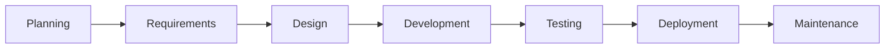

# Spec Kit 如何開發 Spec Kit：代理式 SDLC

Spec Kit 自身的開發結合了代理式工作與傳統的軟體交付。代理評估功能請求、協助開發重大變更，並調查回報的錯誤。專案也在流程合適之處使用 Spec Kit 本身，而確定性的測試與 release 仍是一般的 GitHub Actions，是否繼續或合併則由維護者決定。

公開的工作流程與一項歷史功能，為這個案例研究提供了證據。它們展示了專案 SDLC 的不同路徑，包括專案在哪些地方使用 Spec Kit 本身。

## 專案的軟體開發生命週期

傳統階段標示出專案實務在 SDLC 中的位置。

這些階段是一張地圖，不是一段必須遵循的序列。工作可以從其起始材料與目標所要求的地方開始：一項處於規劃階段的功能請求、一項處於測試階段的既有變更，或一份處於維護階段的錯誤回報。階段可以重疊、重複或略過；一個功能 issue 可以餵給一次評估、記錄需求，並承載設計討論。箭頭展示的是一條熟悉的路徑，而不是 SDLC 階段之間強制性的轉換。來自維護的回饋可以餵給下一個規劃週期。

## 誰做這份工作

這些模式說明工作在這裡如何完成；它們不是詳盡的分類或活動清單。一個階段可以結合多種模式。

**一般自動化。**Script 與 bot 依預先定義的規則執行檢查、提議相依性更新，並發布 release。它們不詮釋功能請求，也不選擇設計。

**代理自動化。**程式代理詮釋脈絡，並產出評估、SDD 產出物、提議的變更或測試報告。它可能透過貢獻者呼叫的 Spec Kit 命令、貢獻者自己的代理，或標籤觸發的儲存庫工作流程來執行。在 GitHub Actions 上執行代理，並不會讓它的推理變成確定性 script。

星號（&#9733;）標示代理式工作：位於散文段落之前與時間軸項目之後。人物圖示（&#128100;）在階段敘述中突顯人類的貢獻，包括在代理協助下完成的工作。

**人類工作。**人們可以框定 issue、討論方法、撰寫或修訂變更，並檢視證據，無論有沒有代理的協助。維護者套用標籤來啟動儲存庫工作流程，並決定是否繼續或合併。這些交接是人類的決定，不是人們親自撰寫每一份評估、規格、修復或測試報告的證據。

## 專案在每個階段如何工作

### 1. 規劃：評估功能請求

功能可以透過[功能請求表單](https://github.com/github/spec-kit/blob/main/.github/ISSUE_TEMPLATE/feature_request.yml)進入規劃。它會詢問問題、提議的解決方案、替代方案、元件與使用案例。產生的 issue 以 `needs-triage` 開始；提交它並不會自動啟動代理。

&#9733; 當功能請求被標記為需要評估時，[feature-assess 代理式工作流程](https://github.com/github/spec-kit/blob/main/.github/workflows/feature-assess.md)會從簽出中佈建 Specify CLI，安裝 Spec Kit 隨附的 [`assess` 擴充功能](assessment.md)，並依循其 intake、research、define、shape 與 decide 階段。代理把證據與 `go`、`needs-clarification` 或 `kill` 判定張貼到 issue。**這是一個使用 Spec Kit 本身的代理式工作流程。**

&#128100; 貢獻者框定請求；維護者決定是否啟動評估，以及如何依其判定採取行動。`go` 的結論為該規劃決定提供資訊；它不會自動開啟功能 PR 或啟動 SDD。

### 2. 需求：在 issue 或規格中記錄意圖

&#128100; 貢獻者可以透過問題陳述、使用案例與驗收準則，在同一個功能 issue 中記錄早期需求，接著在討論中釐清或修訂意圖。對於有邊界的變更，這可能就足夠了；它不必成為 SDD 的 `spec.md`。

&#9733; 對於重大變更，貢獻者可以改用 Spec Kit 的核心 SDD 命令，對照專案憲章擴展需求。Spec Kit 曾在[歷史性的 bundler 工作](https://github.com/github/spec-kit/commit/3fd1e54d4b237af6124bb967e2eae24c93685a89)中把這個流程用在自己身上：該提交包含一份憲章與 `specify bundle` 命令的功能規格。這是**該功能 SDD dogfooding** 的證據；bundler 工作與目前的 `feature-assess` 工作流程是不同的。[貢獻指南](https://github.com/github/spec-kit/blob/main/CONTRIBUTING.md#does-spec-kit-use-spec-kit)要求貢獻者以 SDD 測試相關變更，同時允許小型修復使用一般的 issue 與 PR 流程。產生的 `specs/` 產出物通常會被 gitignore；連結的提交保留了一份歷史快照。

### 3. 設計：在適當的規模選擇方法

&#128100; 功能表單中提議的解決方案與替代方案，可以為設計討論提供種子；貢獻者與維護者可以在 PR 審查期間精煉方法。每個 issue 不都需要獨立的 SDD 計畫。較大的變更需要事先與維護者討論並達成共識，如[貢獻指南](https://github.com/github/spec-kit/blob/main/CONTRIBUTING.md#submitting-a-pull-request)所述。當決策應該在多次變更之間保持有用時，儲存庫會保留 [CLI](https://github.com/github/spec-kit/blob/main/design/cli.md)、[整合](https://github.com/github/spec-kit/blob/main/design/integration.md)與 [workflow-step](https://github.com/github/spec-kit/blob/main/design/workflow-step.md) 設計文件。

&#9733; [bundler SDD 快照](https://github.com/github/spec-kit/commit/3fd1e54d4b237af6124bb967e2eae24c93685a89)說明了更深的路徑：它的計畫、研究、資料模型、契約與任務，透過 `/speckit.plan` 與 `/speckit.tasks` 讓設計變得可執行。這展示了 Spec Kit 本身被使用的地方，但不把那種細節程度呈現為每項變更的預設。

### 4. 開發：做出可審查的變更

[bundler 實作](https://github.com/github/spec-kit/pull/3070)在記錄下來的 SDD 工作之後，加入了 `specify bundle`。這是專案中一個具體的規格主導功能。其他有邊界的變更使用一般的 issue、PR、審查與測試流程。

&#128100; 貢獻者可以直接實作與修訂變更，或在代理的協助下進行。維護者審查產生的 PR 及其證據，即使提議的變更是由代理產出的。

&#9733; 貢獻者可以使用自己的代理，獨立於儲存庫的工作流程之外。由於那份工作可能不會出現在差異中，[貢獻政策](https://github.com/github/spec-kit/blob/main/CONTRIBUTING.md#ai-contributions-in-spec-kit)要求揭露工具、模型、設定或模式，以及 AI 協助的程度。由代理撰寫的提交與留言需要各自的歸屬標示；已知的錯誤修復與社群型錄工作流程不在此限，因為它們的代理身分是固有的。揭露提供的是出處，而不是較低的證據或審查門檻。

### 5. 測試：同時驗證意圖與行為

&#9733; bundler 工作包含一次[收斂 pass](https://github.com/github/spec-kit/commit/de1c8ce6765f07cd1c4728a251b95adbfa3a8d07)，它追加了一項缺漏的任務。這是 Spec Kit 的 SDD 流程對照意圖檢查實作的一個範例，而不是把第一遍當成完成。[bug-test 工作流程](https://github.com/github/spec-kit/blob/main/.github/workflows/bug-test.md)使用代理來選擇相關測試，但測試命令本身仍以確定性方式執行。

&#9733; 維護者也可以把 `pr-assess` 套用到 PR 上，來要求 [pr-assess 工作流程](https://github.com/github/spec-kit/blob/main/.github/workflows/pr-assess.md)。它把描述與累積差異比較，回報實質的遺漏或矛盾，並套用 `pr-description-aligned`、`pr-description-needs-update` 或 `pr-description-inconclusive` 其中一個標籤。它最多移除兩個過時的結果標籤，接著只有在所選結果不存在時才加入它。若唯一的結果標籤已相符，標籤保持不變；衝突的結果會被清理，但不會僅因該衝突就改變對描述的判定。每份完成的評估都會張貼一則新的獨立留言，包括相符的重跑。建議的更新僅限描述，不是程式碼變更的替代方案。這個 MVP 使用分開的移除／加入操作，可能部分失敗，也無法讓並行的手動標籤編輯變得安全。留言交付也是分開的。它讀取儲存庫與 fork 的變更，但不執行貢獻者的程式碼。標錯的 issue 或已關閉的 PR 會收到一則說明留言，而不是判定。重新評估是手動的：移除再重新加入觸發標籤。這檢查的是描述的一致性，不是作者的意圖或一般的程式碼品質，也不能取代人類審查。

另外，傳統的 GitHub Actions 會在 PR 與推送到 `main` 時執行 [Python 測試與 Ruff](https://github.com/github/spec-kit/blob/main/.github/workflows/test.yml)、[文件的 Markdown lint 與 shell script 的 ShellCheck](https://github.com/github/spec-kit/blob/main/.github/workflows/lint.yml)，以及 [CodeQL](https://github.com/github/spec-kit/blob/main/.github/workflows/codeql.yml)。代理式收斂是對那些獨立檢查的補充。

&#128100; 貢獻者為變更提供測試與重現證據；維護者評估修補與證據是否回應了陳述的需求，而不只是檢查是否通過。

### 6. 部署：在沒有代理的情況下發布

Spec Kit 儲存庫使用一般的 GitHub Actions 進行交付。[手動派送的 release 觸發器](https://github.com/github/spec-kit/blob/main/.github/workflows/release-trigger.yml)設定版本、建立標籤，並開啟 release PR。該標籤會觸發傳統的 [GitHub Release](https://github.com/github/spec-kit/blob/main/.github/workflows/release.yml)。另一個分開派送的工作流程會[建置並發布到 PyPI](https://github.com/github/spec-kit/blob/main/.github/workflows/publish-pypi.yml)；`main` 上 `docs/` 的變更會觸發 [DocFX 部署](https://github.com/github/spec-kit/blob/main/.github/workflows/docs.yml)。這些傳統 Actions 處理確定性的交付，不使用代理或 Spec Kit 命令。

&#128100; 維護者選擇何時啟動 release，以及是否指定版本而不是使用自動的 patch 遞增。他們之後為該標籤派送 PyPI 發布，並審查 release PR。

### 7. 維護：調查、修復與學習

&#128100; 回報者透過[錯誤回報表單](https://github.com/github/spec-kit/blob/main/.github/ISSUE_TEMPLATE/bug_report.yml)提供觀察到的與預期的行為，以及重現步驟。維護者分流回報，選擇何時要求每個代理步驟，並在合併前審查提議的修復與測試證據。回報可能在 release 之前或之後出現；新發現的需求可以餵給下一個規劃週期，而不是折進一次修復裡。

&#9733; 儲存庫在 issue 上使用分開的 [bug-assess](https://github.com/github/spec-kit/blob/main/.github/workflows/bug-assess.md)、[bug-fix](https://github.com/github/spec-kit/blob/main/.github/workflows/bug-fix.md) 與 [bug-test](https://github.com/github/spec-kit/blob/main/.github/workflows/bug-test.md) 代理式工作流程。它們以人類控制的交接，分開診斷、修復與驗證；修復會以草稿 PR 的形式提出，供維護者審查。**目前這些專案工作流程並不取用 Spec Kit 隨附的 [`bug` 擴充功能](bugfix.md)**，即使它為使用者提供了對應的 assess、fix、test 流程。讓這些工作流程使用該擴充功能，是未來工作的方向，不是目前的能力或已承諾的 release。

代理式與傳統工作流程都跑在 GitHub Actions 上。改變的是代理是否詮釋證據或提議變更。[Dependabot](https://github.com/github/spec-kit/blob/main/.github/dependabot.yml) 也會每週提出 pip 與 GitHub Actions 相依性更新 PR，供維護者審查；它是傳統自動化，不是代理式工作流程。

## 擴充性與社群實務

擴充性貫穿這個 SDLC：專案既建構與發行流程，也使用它們。團隊發布 [`assess` 套件組](https://github.com/github/spec-kit/tree/main/bundles/assess) 與 [`bugfix` 套件組](https://github.com/github/spec-kit/tree/main/bundles/bugfix)，每個都把一個擴充功能與一個可恢復的 *Spec Kit 工作流程* 以及一道人類審查關卡結合起來。它還發布 [`lean` 預設集](https://github.com/github/spec-kit/tree/main/presets/lean)，展示塑造核心 SDD 指引的另一種方式。這些是 Spec Kit 自己的[擴充功能、預設集、工作流程與套件組](customization.md)，不是儲存庫的 GitHub Actions 工作流程。

&#9733; 除了核心功能交付之外，針對 [擴充功能](https://github.com/github/spec-kit/blob/main/.github/workflows/add-community-extension.md)、[預設集](https://github.com/github/spec-kit/blob/main/.github/workflows/add-community-preset.md)、[套件組](https://github.com/github/spec-kit/blob/main/.github/workflows/add-community-bundle.md) 與 [工作流程步驟](https://github.com/github/spec-kit/blob/main/.github/workflows/add-community-workflow-step.md) 的代理式社群提交工作流程，會驗證提交中繼資料，並在草稿 PR 中提議型錄變更，供維護者審查。

擴充功能、預設集與套件組的提交標題，分別需要 `[Extension]:`、`[Preset]:` 與 `[Bundle]:` 前綴。不相符者會收到一則留言與執行連結，接著處理會停止，不做驗證或其他變更。

型錄探索不會稽核或背書社群程式碼；使用者在使用第三方元件之前，必須自行檢視。

## 我們如何從 SDLC 走到代理式 SDLC

代理式實務是分層加入既有的 SDLC，而不是取代傳統的檢查與 release。提交歷史展示了那種組合如何隨時間浮現。這些是精選的里程碑，不是詳盡的變更紀錄。同一個星號標示代理式里程碑，包括使用 Spec Kit 的 SDD 流程；傳統自動化與政策則不標示。

| 月份 | 變更內容 |
| --- | --- |
| August 2025 | <ul><li>加入了 <a href="https://github.com/github/spec-kit/commit/28fdfaa8">GitHub Release 自動化</a>。</li></ul> |
| September 2025 | <ul><li>加入了 <a href="https://github.com/github/spec-kit/commit/4b98c20f">文件部署</a>。</li><li><a href="https://github.com/github/spec-kit/commit/6f3e450c">貢獻指南</a>開始要求揭露 AI 協助，包括貢獻者執行的代理。</li></ul> |
| October 2025 | <ul><li><a href="https://github.com/github/spec-kit/commit/33a07969">Markdown linting</a> 加入 PR 與 <code>main</code> 檢查。</li></ul> |
| February 2026 | <ul><li><a href="https://github.com/github/spec-kit/pull/1622">Dependabot</a> 開始提出每週的 pip 與 GitHub Actions 相依性更新 PR。</li><li>為程式碼掃描加入了 <a href="https://github.com/github/spec-kit/commit/9402ebd0">CodeQL 工作流程</a>。</li><li><a href="https://github.com/github/spec-kit/pull/1637">Pytest CI</a> 開始在 PR 與推送到 <code>main</code> 時執行測試。</li><li><a href="https://github.com/github/spec-kit/pull/1637">Ruff linting</a> 加入 Python CI 工作流程。</li></ul> |
| May 2026 | <ul><li><a href="https://github.com/github/spec-kit/pull/2655">擴充功能提交</a>取得了型錄驗證與草稿 PR。 &#9733;</li><li><a href="https://github.com/github/spec-kit/pull/2655">預設集提交</a>取得了型錄驗證與草稿 PR。 &#9733;</li></ul> |
| June 2026 | <ul><li>加入了 <a href="https://github.com/github/spec-kit/pull/3023">代理式 bug-assess 工作流程</a>。 &#9733;</li><li><a href="https://github.com/github/spec-kit/commit/3fd1e54d4b237af6124bb967e2eae24c93685a89">bundler 功能</a>使用 Spec Kit 的 SDD 流程產出其規格、計畫與任務。 &#9733;</li><li><a href="https://github.com/github/spec-kit/pull/2915">PyPI 發布</a>取得了一個傳統工作流程。</li><li><a href="https://github.com/github/spec-kit/pull/3126">ShellCheck</a> 開始在 CI 中檢查 shell script。</li></ul> |
| July 2026 | <ul><li><a href="https://github.com/github/spec-kit/pull/3258">Bug-fix</a> 以人類交接擴展了代理式 issue 工作流程。 &#9733;</li><li><a href="https://github.com/github/spec-kit/pull/3257">Bug-test</a> 加入了一個獨立的驗證階段。 &#9733;</li><li><a href="https://github.com/github/spec-kit/pull/3553">套件組提交</a>取得了型錄自動化。 &#9733;</li></ul> |
| August 2026 | <ul><li><a href="https://github.com/github/spec-kit/pull/4186">feature-assess 工作流程</a>開始在功能請求上使用 Spec Kit 的 <code>assess</code> 擴充功能。 &#9733;</li></ul> |
| September 2026 | <ul><li><a href="https://github.com/github/spec-kit/pull/4512">AI 揭露</a>開始要求代理、模型、設定與程度。</li><li><a href="https://github.com/github/spec-kit/pull/4752">貢獻指引</a>為由代理撰寫的提交與留言加入了歸屬標示。</li></ul> |

這不是從傳統自動化到代理的交接。測試、lint、掃描與發布，把可重複的工作保留在 GitHub Actions 中，而揭露讓貢獻者執行的代理變得可見。專案為有邊界的任務加入了代理式型錄與錯誤工作流程，在一項重大功能上使用了 SDD，之後又讓功能評估取用 Spec Kit 的 `assess` 擴充功能。這些是分開加入的，不是每個 issue 都必須遵循的步驟。

它們合在一起，為專案提供了選擇。對於功能，`assess` 可以為人類對某項請求的決定提供資訊；重大的實作工作可以使用 SDD 來規格化並計畫它，一如 bundler 所做的。這些流程之間沒有自動的交接。一項小型變更可以留在 issue 與 PR 中，而一個錯誤可以走過人類把關的評估、修復與驗證。程式碼變更仍要面對傳統檢查與維護者審查；issue 判定與型錄提議有各自的人類關卡。

## 一種正式環境實務，不是一份規定的配方

對於這個公開的開源專案，新 issue 是不受信任的輸入，不是執行代理的許可。維護者用其標籤啟動每個由儲存庫擁有的代理式工作流程，並決定工作何時推進；貢獻者也可以帶來自己的代理，但須受揭露與審查約束。這些是這個專案刻意設定的邊界，不是 Spec Kit 固有的限制。

一個信任模型不同的封閉專案，可以在評估、規格、實作與測試之間自動化更多交接，同時讓權限、證據與審查與風險相稱。Spec Kit 在正式環境中的組合不是一份規定的配方：團隊可以在不同的地方採用代理，無論有沒有 Spec Kit 的流程。那種組合可以隨專案的需求與實務而改變。

在這裡，代理式不代表沒有人類：貢獻者仍帶來問題、需求與變更；維護者引導產品方向、指引交付並審查證據。傳統自動化處理可重複的檢查與發布，而代理協助需要詮釋的有邊界工作。這種分工旨在把人類的時間聚焦在判斷上，儘管時間軸展示的是採用情形，而不是量測到的時間節省。
