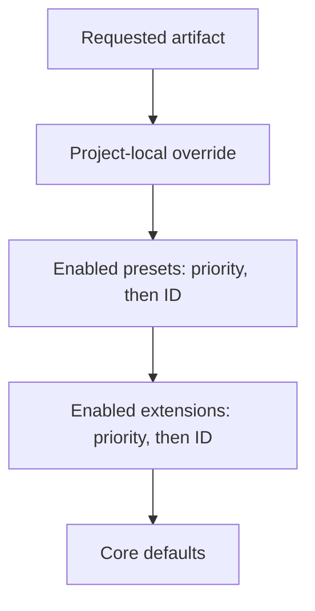

# 預設集 API 參考

本參考定義預設集資訊清單、組合與交付規則，以及已安裝狀態。CLI 參考說明終端機命令；開發指南逐步介紹如何建立套件。

## 資訊清單

每個預設集都有一個 UTF-8 編碼的 `preset.yml`，其根節點為 YAML 對應。

| 欄位 | 必要 | 契約 |
| --- | --- | --- |
| `schema_version` | 是 | 字串 `"1.0"` |
| `preset` | 是 | 中繼資料對應 |
| `preset.id` | 是 | 符合 `[a-z0-9-]+` 的字串 |
| `preset.name` | 是 | 人類可讀的字串 |
| `preset.version` | 是 | Python `packaging.version.Version` 接受的引號字串 |
| `preset.description` | 是 | 說明字串 |
| `preset.author` | 否 | 作者中繼資料 |
| `preset.repository` | 否 | 儲存庫 URL 中繼資料 |
| `preset.license` | 否 | 授權中繼資料 |
| `requires` | 是 | 需求對應 |
| `requires.speckit_version` | 是 | 非空字串；安裝期間以 PEP 440 規格字串檢查 |
| `requires.extensions` | 否 | 擴充功能 ID 或相依性對應的清單 |
| `provides` | 是 | 貢獻對應 |
| `provides.templates` | 是 | 非空的貢獻對應清單，包含命令與指令碼 |
| `tags` | 否 | 探索標籤；使用小寫字串清單 |

已發布的預設集請使用描述性、以字母開頭、小寫連字號形式的 ID，以及 `X.Y.Z` 版本。社群提交契約比執行階段資訊清單驗證器更嚴格：它要求 ID 符合 `[a-z][a-z0-9-]*`、數字形式的 `X.Y.Z` 版本，以及儲存庫、文件、授權與發行資訊。僅憑執行階段的中繼資料驗證，不足以證明預設集符合型錄提交需求。

版本與約束請加上引號：例如 `version: 1.0` 這類 YAML 值是數字，而非版本字串。不相容的 Spec Kit 版本或無效的 Spec Kit 規格字串會導致安裝失敗。

### 貢獻欄位

`provides.templates` 中的每個項目都使用以下結構：

```yaml
provides:
  templates:
    - type: "template"
      name: "spec-template"
      file: "templates/spec-addendum.md"
      description: "Adds team requirements"
      strategy: "append"
```

| 欄位 | 必要 | 契約 |
| --- | --- | --- |
| `type` | 是 | `template`、`command` 或 `script` |
| `name` | 是 | 邏輯產出物名稱，而非來源檔案名稱 |
| `file` | 是 | 預設集內的相對路徑，不得含父層遍歷 |
| `description` | 否 | 貢獻說明 |
| `strategy` | 否 | 預設為 `replace`；接受的字串會正規化為小寫 |
| `selector` | 僅適用 `replace-section` | 非空的小寫章節錨點；不含前導 `#` |

範本與指令碼名稱使用小寫字母、數字與連字號。命令名稱還可使用點號；例如 `speckit.specify` 或 `speckit.myext.report`。重複的 `(name, type)` 配對會被拒絕，但不同類型可以共用同一個名稱。

產出物一經宣告，資訊清單中的 `file` 即為權威依據。宣告的路徑若缺失或不是檔案，不會退回使用同一預設集內的其他慣用檔案。請確保所有宣告的檔案都存在：資訊清單的結構驗證並非完整的套件內容檢查。當資訊清單缺失或未宣告所要求的名稱時，舊版查閱可使用慣用路徑。

### 擴充功能相依性

```yaml
requires:
  speckit_version: ">=0.9.0"
  extensions:
    - "companion-extension"
    - id: "other-extension"
      version: ">=1.2.0,<2"
      required: false
```

僅寫 ID 表示必要且無版本約束。對應形式的項目必須有符合 `[a-z0-9-]+` 的 `id`；選填的 `version` 必須是有效的非空 PEP 440 規格字串，`required` 必須是布林值，預設為 `true`。精確釘選、排除條件與上限皆為有效寫法。

相依性僅供建議，不會自動安裝。安裝完成後，CLI 會針對必要的擴充功能發出警告，若其缺失、登錄項目損毀、檔案缺失、已停用，或可比較的版本不符合約束。缺失或已停用的功能仍無法使用。版本不符並不會停用擴充功能；它仍可執行，但行為可能與預期不同。

選填相依性一律不會發出警告。無法解析或缺失的已記錄版本屬於無法比較，不會回報為不符。解析器接納的擴充功能目錄即使沒有登錄項目，也視為可用，但沒有可供比較的已記錄版本。擴充功能登錄檔無法讀取時，便無法進行這項安裝後的相依性檢查；沒有警告並不代表相依性已通過驗證。

相依性請宣告在資訊清單中，而不只是型錄項目：`--dev` 與 `--from` 不會查閱型錄。即使是自成一體、具命名空間的取代命令，仍會在沒有同名擴充功能的情況下交付。

## 檔案解析

每個 `(name, type)` 皆獨立評估：



在預設集與擴充功能層級中，優先順序數字越小越優先，其次以字母順序的 ID 打破平手。已停用的項目會被排除。安全的未登錄擴充功能目錄以隱含優先順序 `10` 參與；已停用、損毀或缺失的已登錄擴充功能，不會再以未登錄貢獻的形式重新納入。

| 類型 | 專案本機覆寫 | 慣用預設集子目錄 |
| --- | --- | --- |
| 範本 | `.specify/templates/overrides/<name>.md` | `templates/`，含舊版根目錄查閱 |
| 命令 | `.specify/templates/overrides/<name>.md` | `commands/` |
| 指令碼 | `.specify/templates/overrides/scripts/<name>.<ext>` | `scripts/` |

核心查閱包含專案預設值與封裝的核心資產；對於可編輯／原始碼安裝，則為儲存庫資產。命令查閱可將 `speckit.<stem>` 對應到核心的 `<stem>.md` 檔案名稱。如此一來，即使專案沒有 `.specify/templates/commands/` 的副本，也能針對核心命令進行組合。

### 組合策略

| 類型 | `replace` | `prepend` | `append` | `wrap` | `replace-section` |
| --- | --- | --- | --- | --- | --- |
| 範本 | 預設 | 支援 | 支援 | `{CORE_TEMPLATE}` | 支援 |
| 命令 | 預設 | 支援 | 支援 | `{CORE_TEMPLATE}` | 支援 |
| 指令碼 | 預設 | 不支援 | 不支援 | `$CORE_SCRIPT` | 不支援 |

優先順序最高的 `replace` 層會完全勝出。否則，解析會找到最近的下層 `replace` 基準，再由下而上僅套用其上方的層級。前置與附加會以空白行分隔兩段內容。包裝佔位符會由實際的下層內容取代，而該內容可能已包含其他預設集的客製化。

位於勝出的 `replace` 基準下方的無效章節宣告，不會阻擋解析。貢獻堆疊中的章節宣告仍會受到嚴格驗證。

若無 `replace` 基準，組合便無法產出內容。命令註冊會發出警告並跳過無法組合的命令，而不是僅憑其命名空間就要求提供擴充功能。包裝缺少必要的佔位符時，會在組合期間引發預設集驗證錯誤。

組合後的命令主體不會內嵌每一層的 YAML frontmatter。解析會使用優先順序最高的可用 frontmatter，並在缺少時從基準繼承 `scripts`、`agent_scripts` 與 `argument-hint`。內部的 `strategy` 鍵會從組合輸出中移除。接著由使用中的整合以其支援的命令或技能格式算繪結果。

### 章節取代

使用 `replace-section` 可自訂某一個 Markdown 章節，而不必複製整份底層文件：

```yaml
provides:
  templates:
    - type: template
      name: spec-template
      file: templates/team-requirements.md
      strategy: replace-section
      selector: requirements
```

檔案包含完整的取代**內文**，而不是所選的標題。空檔案會刪除該內文。內文從標題行之後開始，延伸至下一個同層級或更高層級的標題，或文件結尾。下層章節屬於該內文的一部分。原始標題與內文以外的所有文字維持不變，包括行結尾。請自行提供後續標題之前所需的空白行與結尾換行；此策略不會自動插入空白行分隔。若標題位於文件結尾（EOF）且沒有行結束符，非空的取代內容會取得一個分隔用的行結束符，除非片段本身已以行結束符開頭。這會採用文件的最後一種行結尾樣式，若無則預設為 LF。空的取代內容不會更動未以行結束符結尾的標題。

請在 `preset.yml` 中同時宣告 strategy 與 selector，而不是在命令 frontmatter 中。`selector` 用於其他策略時會被拒絕。此功能是在資訊清單結構描述 `"1.0"` 之下的附加功能；散布預設集時，請將 `requires.speckit_version` 設為支援此策略的版本。

選取器採用有界的 GitHub 風格錨點契約：

- ATX 標題有一至六個前導 `#` 字元、最多三個前導空格，標題標記後方為空白字元或行尾。選用的結尾雜湊標記不計入標題文字。
- 行內強調／程式碼格式會被移除，但保留其文字；行內連結貢獻的是其標籤，而非目的地，包括含有平衡括號的目的地。程式碼片段內容在強調處理期間保持原樣，因此 `` `__init__` `` 會保留其底線。完整的相符底線強調序列，包括 `___Target___`，會被剝除；僅憑格式無法區分其他方面相同的重複標題錨點。
- 將文字轉為小寫，移除連字號與底線以外的標點／符號，保留 Unicode 字母／數字，並將每個空格換成一個連字號。重複的空格不會合併。
- `## Review & Approval!` 會變成 `review--approval`；`## API_v2 - Notes` 會變成 `api_v2---notes`；`## **Café** Guide` 會變成 `café-guide`。
- 選取器必須完全相符，不得含前導 `#`、模糊比對、父層路徑或重複編號。兩個標題即使層級不同，只要正規化後的錨點相同，就會被視為含糊。

反引號與波浪號圍欄程式碼在比對與章節邊界判定時都會被忽略。圍欄最多可有三個前導空格；結尾圍欄使用相同標記，且長度至少與開頭圍欄相同。反引號圍欄的資訊字串不得包含反引號。未閉合的圍欄會保護文件的其餘部分。開頭的 YAML 中繼資料不參與標題識別。不支援 Setext 標題、HTML 標題與明確的 HTML 錨點目標。

取代會套用至目前為止已組合的文件，並依既有的優先順序進行。稍後、優先順序較高的章節取代，可以取代先前對同一內文的取代。僅限章節的命令編輯會完整保留底層命令的 frontmatter；章節內文檔案不提供取代用的命令中繼資料。與其他命令策略混用時，仍維持其既定的中繼資料合併行為。

必須恰好有一個相符項目。零個相符項目會以 `SECTION_NOT_FOUND` 失敗；多個相符項目會以 `SECTION_AMBIGUOUS` 失敗。診斷資訊會指出預設集、貢獻檔案、目標產出物、選取器、相符數量與補救方式。含糊的診斷資訊包含候選標題文字，以及在當下已組合文件中的行號（從 1 起算）。這些欄位與錯誤識別碼是穩定的；散文措辭可能變更。遺漏相符項目時，請檢查選取器／目前的標題；含糊相符時，請讓正規化後的標題錨點保持唯一。不會回傳首次相符的備援結果或成功但未變更的結果。

可執行指令碼無法使用此策略。它不是通用的 Markdown 編輯器。執行階段範本輔助程式使用與 CLI 相同的章節語意；命令具體化仍由 CLI 負責。請讓受管理的配套 Python 輔助程式與每個指令碼變體一併安裝。以資訊清單為基礎的殼層組合本就要求 Python 3 與 PyYAML。

## 命令與技能生命週期

安裝會將預設集檔案複製到 `.specify/presets/<id>/`，並在組合其命令之前記錄該預設集。初始註冊與安裝後的協調會具體化實際的堆疊，因此安裝順序不會決定最終勝出的命令。

對於已初始化的專案，交付僅針對已記錄的使用中整合。技能模式會為命令式整合發出技能，而非第二種命令表示法；原生技能整合則使用其原生格式。通用整合不會註冊預設集覆寫。使用 `specify integration use <key>` 或 `switch <key>` 切換時，會為新啟用的整合重新搭建已啟用的預設集。

沒有 `init-options.json` 的舊版專案仍保留偵測式命令註冊。已存在但損毀或格式錯誤的選項檔案，不會觸發該全代理備援機制。

移除會清理已記錄的輸出，並協調存留的預設集、擴充功能、覆寫或核心貢獻。它也能還原受影響的命令或技能輸出，範圍包括被移除預設集所記錄的先前使用中整合目錄，以及目前的整合。啟用、停用與優先順序變更會更新解析狀態，但本身不會重新搭建已交付的命令或技能。

憲章生命週期與代理命令交付不同。預設情況下，憲章由憲章命令解析，而非在每次堆疊變更時重寫。啟用 `constitution-sync` 時，受保護的協調會利用產生內容的來源資訊，避免覆寫人工撰寫的憲章。

## 已安裝狀態

| 位置 | 角色 |
| --- | --- |
| `.specify/presets/<id>/preset.yml` | 已安裝的資訊清單 |
| `.specify/presets/<id>/` | 已複製的套件檔案 |
| `.specify/presets/.registry` | 含有 `schema_version: "1.0"` 與 `presets` 對應的 JSON 登錄檔 |
| `.specify/presets/.cache/` | 型錄快取與下載工作檔案 |
| `.specify/memory/.constitution-template.json` | 具體化時產生的憲章來源資訊 |

登錄中繼資料記錄版本、資訊清單雜湊、啟用狀態、優先順序、安裝時間戳記、來源，以及已登錄的命令／技能輸出。新版輸出追蹤會將整合鍵對應到名稱清單；舊版技能追蹤可能是扁平清單。請將其視為 CLI 管理的狀態，而非套件資訊清單或穩定的 JSON 檢查 API。

型錄安裝會記錄 `{"kind":"catalog","catalog":"<name>"}` 來源資訊。本機目錄、直接 URL 與本機隨附安裝會記錄為本機，而非可重複使用的下載 URL。登錄更新會保留現有的 `installed_at`；先移除再新增的取代方式會建立新的時間戳記。

## 指令碼範本解析

各自 `common` 指令碼中的 Bash `resolve_template`／`resolve_template_content` 與 PowerShell `Resolve-Template`／`Resolve-TemplateContent`，可讓殼層取用者使用範本解析。代理命令與技能的具體化由 Spec Kit 處理，而非由各代理自行處理。

## 另請參閱

- [預設集概覽](overview.md)
- [CLI 參考與 JSON 輸出](cli.md)
- [開發預設集](developing.md)
- [型錄結構描述與設定](catalogs.md)
- [發布預設集](publishing.md)
- [產出物清單與組合堆疊](../overview/artifacts.md)
- [整合管理](../integrations/cli.md)
