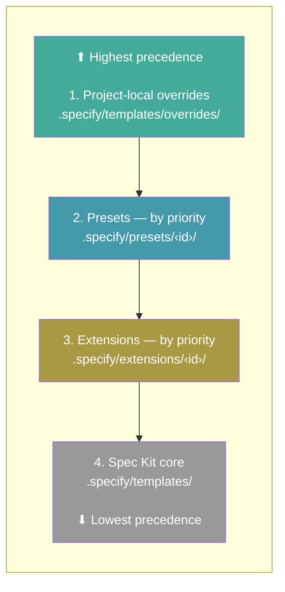
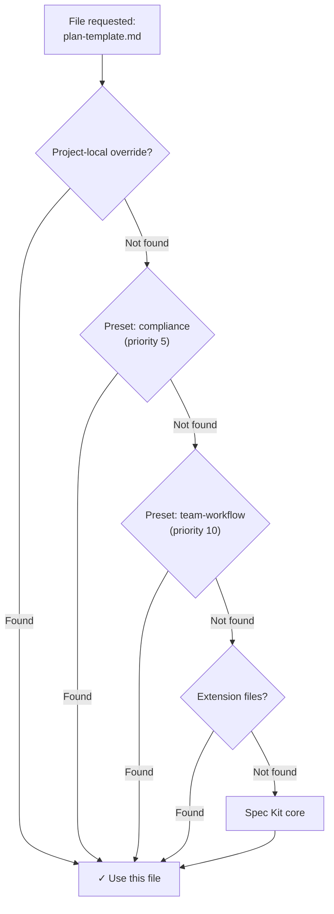

# 預設集

預設集自訂 Spec Kit 的運作方式，覆寫範本、命令與術語，不需變更任何工具。它們可讓你落實組織標準、依方法論調整工作流程，或將整個體驗在地化。多個預設集可以依優先順序堆疊。

## 搜尋可用的預設集

```bash
specify preset search [query]
```

| 選項 | 說明 |
| ---------- | -------------------- |
| `--tag`    | 依標籤篩選        |
| `--author` | 依作者篩選     |

搜尋所有啟用中的型錄，找出符合查詢的預設集。沒有查詢時，列出所有可用的預設集。

## 安裝預設集

```bash
specify preset add [<preset_id>]
specify preset add <preset_id> --version <version>
```

| 選項 | 說明 |
| --------------------- | -------------------------------------------------------------------- |
| `--dev <path>`        | 從本機目錄安裝（供開發使用）                     |
| `--from <url>`        | 從自訂 URL 安裝，而非型錄                     |
| `--version <version>` | 從勝出型錄選取精確版本（僅限 ID 安裝） |
| `--priority <N>`      | 解析優先順序（預設：10；數字越小優先程度越高）        |

從型錄、URL 或本機目錄安裝預設集。預設集命令會自動向受支援的啟用中 AI 程式代理整合註冊。generic 整合目前會交付擴充功能呼叫，但不註冊預設集命令或技能覆寫。`--version` 不能與 `--from` 或 `--dev` 組合使用。直接 URL 安裝仍獨立於型錄查詢。沒有 `--version` 時，安裝仍會選取公告的目前版本（或本機隨附的預設集）。所請求的版本若不在勝出型錄中即為錯誤；較低優先順序的型錄無法提供它。僅供探索的型錄無法安裝任何版本。依版本從型錄安裝時，會在修改已安裝的預設集前，驗證所選封存檔的 `preset.yml` ID 與版本。歷史版本需要 SHA-256 摘要，下載時也會驗證；舊版的目前版本可以省略摘要。

> **注意**：所有預設集命令都需要已以 `specify init` 初始化的專案。

### 以 `.presetignore` 排除開發檔案

在預設集來源根目錄的 `preset.yml` 旁放置 UTF-8 格式的 `.presetignore`（有或沒有位元組順序記號皆可），以篩選複製到 `.specify/presets/<id>/` 的檔案。例如：

```gitignore
# Development-only directories
.git/
.idea/
tests/
```

篩選適用於本機目錄安裝與解壓縮的封存檔，包括由 `preset update` 安裝的重新安裝與取代。若無 `.presetignore`，所有來源檔案會如以往一樣複製。**`.gitignore` 不用於安裝篩選**，且開發檔案沒有隱含的排除。

模式遵循與 `.extensionignore` 相同的 Git 風格比對與正規化：

- 每行一個模式；空白行與 `#` 註解會被忽略。
- `*` 與 `?` 不跨越目錄邊界；`**` 可以跨目錄比對。
- 結尾的 `/` 只比對目錄。開頭的 `/`，或模式中除結尾斜線外的 `/`，會將模式錨定到來源根目錄。沒有這類斜線的模式會比對任何深度的名稱。
- 較後的 `!` 模式會重新包含符合項。被排除的目錄不會被遍歷，因此當其父目錄仍被排除時，子項目無法被重新包含。
- 模式空白會被修剪，反斜線會正規化為 `/`，與既有的擴充功能行為相符。非 ASCII 名稱請使用 UTF-8。

若只保留 `docs/` 內的 `docs/api.md`，請排除目錄的內容，而非目錄本身：

```gitignore
docs/*
!docs/api.md
```

使用 `docs/`，然後 `!docs/` 與 `!docs/api.md`，會重新包含 `docs/` 下的所有檔案，而不僅是 `api.md`，除非其他模式將它們排除。

只有來源根目錄的 `.presetignore` 會被讀取；巢狀的忽略檔案不會新增規則。當根目錄的 `.presetignore` 存在時，任何深度的名為 `.presetignore` 的檔案都會被排除，即使被否定也一樣。否則，巢狀的 `.presetignore` 檔案會原封不動地複製。資訊清單與宣告的資產檔案不豁免於篩選：請保持 `preset.yml` 以及預設集所需的任何範本、命令或指令碼被包含。排除它們可能導致安裝不完整或無法使用。

對於本機目錄與解壓縮的封存檔，來源目錄安裝程式會在移除既有目的地前讀取並驗證 `.presetignore`，包括強制重新安裝期間。無效的 UTF-8 或格式錯誤的模式會引發預設集驗證錯誤。獨立的 `preset update` 命令保留其下方描述的先移除後新增行為；它不會在移除前預先檢查取代用的忽略檔案。

## 更新預設集

```bash
specify preset update <preset_id> [--from <url>] [--dev <path>] [--priority <N>]
```

透過先執行正常的 `preset remove` 操作，再執行正常的 `preset add` 操作，來取代已安裝的預設集。`--from`、`--dev` 與 `--priority` 會轉傳給 `preset add`；`--from` 與 `--dev` 不能組合使用。沒有明確來源時，add 會透過其通常的隨附與型錄查詢解析預設集。

更新是刻意具破壞性的。參數會在移除任何東西前檢查：`--from` 與 `--dev` 不能組合，`--priority` 必須為 1 或更高，且預設集必須已安裝。除了這些檢查外，取代來源本身不會事先檢查。若移除成功但取代安裝失敗，先前的預設集已經被移除。此命令會回報可複製貼上的 `specify preset add` 重試命令，包括取代來源與優先順序。在 Windows 上，回報的命令會明確格式化為 PowerShell。沒有來源預先檢查、版本比較、資訊清單差異、暫存、復原、自動修復或復原交易。因此，遺失或無效的取代來源可能讓預設集保持被移除狀態。使用 `--from` 或 `--dev` 時，取代資訊清單的 `preset.id` 不會在移除前與所請求的 ID 比對；宣告不同 ID 的來源，因此可能在所請求的預設集被移除後，安裝不同的預設集。

成功的更新遵循正常的移除與新增行為：它會重新啟用預設集、重新建立 `installed_at`、移除預設集追蹤的本機修改，並將明確的 `--from` 或 `--dev` 視為有意的來源變更。若啟用了憲章同步，兩個正常的對帳流程都會執行。若 add 在移除後失敗，產生的憲章可能保持與不含被移除預設集的堆疊對帳。產生的檔案防護仍保護手動編輯的 `.specify/memory/constitution.md`。沒有套用更新專屬的憲章最佳化，因此正常的移除與新增流程即使最終解析內容不變，也可能重寫產生的憲章。

## 移除預設集

```bash
specify preset remove <preset_id>
```

移除已安裝的預設集，並清理其已註冊的命令。

## 列出已安裝的預設集

```bash
specify preset list
specify preset list --json
```

列出已安裝的預設集，包含其版本、說明、範本數量與目前狀態。

`--json` 將 JSON 陣列寫入 stdout。每個項目都有鍵 `id`、`name`、`description`、`version`、`author`、`priority`、`enabled`、`source` 與 `provides`。`author` 在缺席時為 `null`；`source` 對於本機、舊版或格式錯誤的來源為 `{"kind":"local"}`，對於有效的型錄來源為 `{"kind":"catalog","catalog":"<catalog-name>"}`。預設集的 `provides` 包含 `commands`、`templates` 與 `scripts` 數量。成功時，`--json` 恰好將一個陣列寫入 stdout 並以 0 結束。在選項解析後的執行時期失敗，會恰好將一個 `{"error":"..."}` 物件寫入 stderr 並以 1 結束。若解析引發使用錯誤且原始 `--json` 權杖存在，它會將該 JSON 錯誤物件寫入 stderr 並保留使用結束代碼（通常為 2）。沒有 `--json` 時，包括說明，現有的人類可讀行為不變。

預設集以**解析／優先順序**列印：優先程度最高的預設集（優先順序數字最小）列在第一位，優先順序相同時依預設集 id 字母順序決斷。這與組成命令與解析範本時使用的順序相符，因此最上面的項目就是重疊檔案的勝出者。

## 預設集資訊

```bash
specify preset info <preset_id>
specify preset info <preset_id> --versions
specify preset info <preset_id> --json
```

顯示已安裝或可用預設集的詳細資訊，包括其範本、中繼資料與標籤。`--versions` 列出公告的目前版本，後接歷史型錄版本，即使是僅供探索的項目也一樣；列出不會讓它們變得可安裝。此檢視查詢的是型錄，而非已安裝的預設集。

`--json` 描述一個依 ID 比對的已安裝預設集，並將單一 JSON 物件寫入 stdout。此物件具有與對應的 `specify preset list --json` 項目相同的 `id`、`name`、`description`、`version`、`author`、`priority`、`enabled` 與 `source` 鍵。它以 `commands`、`templates` 與 `scripts` 陣列取代 `provides` 數量，每個資訊清單貢獻依宣告順序一項。每項都有 `name`、`description`（缺席或空白時為 `""`）、`source`（`{"layer": "preset", "presetId": "<id>"}`，即提供它的預設集；最上層的 `source` 是它安裝的來源）、`sourcePath`（資訊清單的 `file`，相對於預設集目錄）與 `strategy`（`replace`、`prepend`、`append` 或 `wrap`；資訊清單省略時為 `replace`）。`--json` 不能與 `--versions` 組合（使用錯誤，結束代碼 2）。未安裝的預設集（包括只在型錄中的），或遺失的專案，會將一個 `{"error":"..."}` 物件寫入 stderr 並以 1 結束；使用錯誤保留其結束代碼（通常為 2），與 `list --json` 相同。

## 解析檔案

```bash
specify preset resolve <name>
```

透過追蹤完整的解析堆疊，顯示給定名稱將使用哪個檔案。當多個預設集提供相同檔案時，對於除錯很有用。

## 啟用／停用預設集

```bash
specify preset enable <preset_id>
specify preset disable <preset_id>
```

停用預設集而不移除它。停用的預設集在檔案解析時會被略過，但其命令仍保持註冊。以 `enable` 重新啟用。

## 設定預設集優先順序

```bash
specify preset set-priority <preset_id> <priority>
```

變更已安裝預設集的解析優先順序。數字越小優先程度越高。當多個預設集提供相同檔案時，優先順序數字最小者勝出。

## 型錄管理

預設集型錄控制 `search` 與 `add` 尋找預設集的位置。型錄依優先順序檢查（數字越小優先程度越高）。

> **專案的 `.specify/preset-catalogs.yml` 可以將 `add` 與 `search` 指向你沒有選擇的型錄**。在不熟悉的專案中安裝預設集前，請執行 `specify preset catalog list` 並檢查任何標為允許安裝的型錄，專案提供該設定，或將型錄標為允許安裝，都不是其預設集已獲檢視的證據。只將你自己撰寫或已審查的型錄標為 `install_allowed`；不熟悉與社群型錄請保持僅供探索。

### 列出型錄

```bash
specify preset catalog list
```

顯示所有啟用中的型錄，包含其優先順序與安裝權限。

### 新增型錄

```bash
specify preset catalog add <url>
```

| 選項 | 說明 |
| -------------------------------------------- | -------------------------------------------------- |
| `--name <name>`                              | 必要。型錄的唯一名稱              |
| `--priority <N>`                             | 優先順序（預設：10；數字越小優先程度越高）  |
| `--install-allowed / --no-install-allowed`   | 是否可從此型錄安裝預設集（預設：僅供探索）。只對你擁有並審查的型錄啟用；絕不對未經審查的公開型錄啟用。 |
| `--description <text>`                       | 選用的說明                               |

將型錄新增到專案的 `.specify/preset-catalogs.yml`。

以相同設定重新新增同名型錄會成功，且不變更設定；不同的設定會被拒絕。

### 移除型錄

```bash
specify preset catalog remove <name>
```

從專案設定中移除型錄。

### 型錄解析順序

型錄依此順序解析（第一個符合者勝出）：

1. **環境變數**——`SPECKIT_PRESET_CATALOG_URL` 覆寫所有型錄
2. **專案設定**——`.specify/preset-catalogs.yml`
3. **使用者設定**——`~/.specify/preset-catalogs.yml`
4. **內建預設值**——官方型錄 + 社群型錄

### 具版本的型錄項目

既有的單一版本項目仍有效：最上層的 `version`、`download_url`、選用的 `sha256` 與 `requires` 描述公告的目前版本。若要保留較舊的可安裝版本，請新增以版本為鍵的 `releases` 對應。每筆歷史記錄都需要自己的封存檔 `download_url`（HTTPS，或本機開發用的 loopback HTTP）與 64 位數 SHA-256 摘要（可選用 `sha256:` 前綴，並有周圍空白）；其他演算法前綴會被拒絕。選用的 `requires` 與 `provides` 適用於該版本，而非繼承目前版本的欄位。其他共用中繼資料，例如名稱與說明，會被繼承。版本鍵必須互不相同，包括 PEP 440 等價拼寫，且不能重複目前版本。重複的 JSON 鍵會在解析丟棄版本記錄前被拒絕。歷史的 `requires.extensions` 項目遵循預設集資訊清單格式：擴充功能 ID 或對應，包含 `id`、選用的版本限制與選用的布林 `required` 旗標。對於 ID 查詢，型錄依優先順序檢查，並在勝出項目停止。在該項目之前遇到的無效或過大酬載會讓解析失敗，而非允許較低優先順序項目繞過其安裝原則。格式錯誤的較低優先順序來源無法阻擋有效的較高優先順序符合項；跨所有來源的搜尋仍會因格式錯誤的型錄而失敗。非物件項目會讓其自身 ID 的精確查詢失敗，但在跨所有型錄搜尋時會被略過，搜尋會保留其他有效項目。當另一個來源可讀取時，無法連線的型錄仍可被略過。若每個來源都失敗，ID 查詢（包括 `info --versions`）會回報取得錯誤，而非聲稱預設集沒有型錄版本。搜尋會驗證每個勝出項目上的歷史版本；來自被遮蔽來源的無效版本歷史，不會阻擋其有效的較高優先順序取代者。

```json
{
  "presets": {
    "my-preset": {
      "name": "My Preset",
      "version": "2.0.0",
      "download_url": "https://example.com/my-preset-2.0.0.zip",
      "sha256": "<64 hex digits for the current archive>",
      "releases": {
        "1.5.0": {
          "download_url": "https://example.com/my-preset-1.5.0.zip",
          "sha256": "<64 hex digits for the older archive>",
          "requires": {"speckit_version": ">=0.8.0"}
        }
      }
    }
  }
}
```

隨附的社群型錄保持僅供探索，不需發佈版本歷史。套件組釘選解析是獨立功能；僅新增這些預設集記錄，不會讓套件組釘選變得可安裝。

`.specify/preset-catalogs.yml` 範例：

```yaml
catalogs:
  - name: "my-org-presets"
    url: "https://example.com/preset-catalog.json"
    priority: 5
    install_allowed: true
    description: "Our approved presets"
```

## 檔案解析

預設集可以提供命令檔案、範本檔案（例如 `plan-template.md`）與指令碼檔案。每個檔案名稱都會獨立對照優先堆疊評估，因此不同檔案可以來自不同層。

範本與指令碼在 Spec Kit 需要時從堆疊中查詢。命令使用相同的堆疊進行取代與組成，但只具體化到啟用中整合的目錄，而非由代理重新解析，或寫入每個偵測到的代理目錄（#2948）。在預設集安裝期間，Spec Kit 會針對目前啟用中的整合，註冊正在安裝的預設集的命令檔案；安裝後與移除後的對帳，會依啟用堆疊重新計算並寫入受影響命令名稱的有效命令內容。安裝與重新建立架構仍僅限啟用中，但移除也可能更新被移除預設集記錄的先前鎖定的未啟用目錄，以還原存活的命令或技能層。未啟用的已安裝整合，否則不會收到這些命令檔案，直到它成為預設值為止，`specify integration use <key>`（或 `switch <key>`）會為新啟用的整合重新建立已啟用預設集的架構。代理在每次執行命令時不會重新解析堆疊。

預設情況下，檔案使用 **replace** 策略：優先堆疊中的第一個符合項勝出並被完整使用。範本與命令也可以使用組成策略：**prepend** 將預設集內容放在較低優先順序內容之前，**append** 將其放在較低優先順序內容之後，**wrap** 以較低優先順序內容取代 `{CORE_TEMPLATE}`。指令碼支援 **replace** 與 **wrap**；指令碼包裝器使用 `$CORE_SCRIPT` 作為佔位符。

解析堆疊，從最高到最低優先順序：

1. **專案本機覆寫**——`.specify/templates/overrides/`
2. **已安裝的預設集**——依優先順序排序（數字越小越先檢查）
3. **已安裝的擴充功能**——依優先順序排序
4. **Spec Kit 核心**——`.specify/templates/`

### 解析堆疊



在每一層內，檔案依類型組織：

| 類型 | 子目錄 | 覆寫路徑 |
| --------- | -------------- | ------------------------------------------ |
| 範本 | `templates/`   | `.specify/templates/overrides/`            |
| 命令 | `commands/`    | `.specify/templates/overrides/`            |
| 指令碼 | `scripts/`     | `.specify/templates/overrides/scripts/`    |

### 解析實例



### 範例

```bash
specify preset add compliance --priority 5
specify preset add team-workflow --priority 10
```

對於兩者都提供的任何檔案，`compliance` 勝出（優先順序 5 < 10）。對於只有一方提供的檔案，使用該方。對於兩者都不提供的檔案，使用核心預設值。

## 常見問題

### 我可以同時使用多個預設集嗎？

可以。預設集依優先順序堆疊，每個檔案都從提供它的最高優先順序來源獨立解析。使用 `specify preset set-priority` 控制順序。

### 如何查看實際使用的是哪個檔案？

執行 `specify preset resolve <name>` 追蹤解析堆疊，查看哪個檔案勝出。

### 停用與移除預設集有什麼區別？

**停用**（`specify preset disable`）讓預設集保持已安裝，但將它排除在未來的範本與指令碼解析之外。先前註冊的命令在你的 AI 程式代理中仍可使用，直到預設集被移除，因此當你需要命令變更停止生效時，請使用移除。停用對於暫時測試不含預設集的範本／指令碼行為，或比較有無預設集時的範本／指令碼輸出很有用。隨時以 `specify preset enable` 重新啟用。

**移除**（`specify preset remove`）會完全解除安裝預設集，刪除其檔案、從你的 AI 程式代理取消註冊其命令，並將它從登錄中移除。

### 誰維護預設集？

大多數預設集由其各自的作者獨立建立與維護。Spec Kit 維護者不檢視、稽核、背書或支援預設集程式碼。安裝前請檢視預設集的原始碼，並自行斟酌使用。若特定預設集有問題，請聯絡其作者或在預設集的儲存庫提出 issue。
