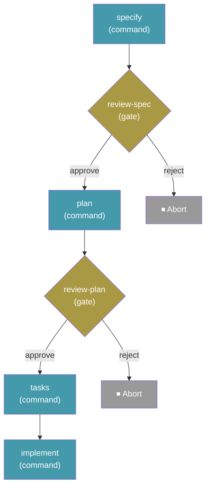

# 工作流程

工作流程可自動化多步驟的規格驅動開發流程，將命令、提示詞、shell 步驟與人工檢查點串連成可重複的序列。它們支援條件邏輯、迴圈、扇出／扇入，並可從中斷的確切位置暫停與繼續。

## 執行工作流程

```bash
specify workflow run <source>
```

| 選項              | 說明                                              |
| ------------------- | -------------------------------------------------------- |
| `-i` / `--input`    | 以 `key=value` 傳入輸入值（可重複使用）            |
| `--json`            | 以單一 JSON 物件輸出執行結果             |

從型錄 ID、URL 或本地檔案路徑執行工作流程。工作流程宣告的輸入可以透過 `--input` 提供，或在互動模式下提示輸入。

範例：

```bash
specify workflow run speckit -i spec="Build a kanban board with drag-and-drop task management"
```

宣告為 `type: number` 的輸入會精確保留整數值與整數字串，包括大於 `2**53` 的 64 位元識別碼與奈秒時間戳記。十進位與指數字串會繼續使用浮點數轉換；全值結果會儲存為整數。布林值、非數值，以及非有限數值會被拒絕。

搭配 `--json` 時，會列印單一機器可讀的物件，而非格式化文字（省略此旗標時，預設輸出不變）：

```bash
specify workflow run my-pipeline.yml --json
```

```json
{
  "run_id": "662bf791",
  "workflow_id": "build-and-review",
  "status": "paused",
  "current_step_id": "review",
  "current_step_index": 0
}
```

`workflow_id` 是 YAML 內部宣告的 `workflow.id`，而非檔案名稱。物件會完全依照所示方式列印：以兩個空格縮排美化列印，輸出到純文字的標準輸出，不含 Rich 標記，因此永遠可以解析。在 `--json` 模式下執行工作流程時，步驟原本會列印的任何進度（例如關卡提示，或提示詞步驟 CLI 子行程的輸出）都會重新導向到標準錯誤，因此標準輸出只承載 JSON 物件。請從標準輸出讀取物件；讓標準錯誤保持連接到終端機，或另行擷取。

對於 `failed` 與 `aborted` 的執行，酬載會包含 `error` 欄位，承載終止步驟的錯誤訊息：

```json
{
  "run_id": "662bf791",
  "workflow_id": "build-and-review",
  "status": "failed",
  "current_step_id": "boom",
  "current_step_index": 0,
  "error": "Command exited with code 3"
}
```

`completed` 與 `paused` 的執行會省略 `error` 欄位。錯誤會保存於該次執行的 `state.json` 中，因此事後 `specify workflow status <run_id> --json` 也會呈現相同的訊息。

在建立或載入執行狀態之前發生的配接器載入失敗，會使用執行前失敗封套：新的執行沒有執行 ID，而繼續執行則保留所提供的執行 ID，但沒有工作流程或步驟內容。執行狀態存在之後，來自逐步驟重新載入或已驗證延遲匯入的配接器失敗，會保留實際的執行、工作流程與目前步驟欄位，就如同執行 I/O 失敗一樣。若儲存狀態失敗，磁碟上的狀態可能仍反映最後一次成功儲存的結果，而非回報的 I/O 失敗。

> **注意：** 大多數工作流程命令都需要已使用 `specify init` 初始化的專案。例外是 `specify workflow run <local-file.{yml,yaml}>`，可以在專案外執行；此時，執行狀態會儲存在目前目錄的 `.specify/workflows/runs/<run_id>/` 下。

## 繼續工作流程

```bash
specify workflow resume <run_id>
```

| 選項              | 說明                                              |
| ------------------- | -------------------------------------------------------- |
| `-i` / `--input`    | 以 `key=value` 提供更新的輸入值（可重複使用）         |
| `--json`            | 以單一 JSON 物件輸出繼續結果          |

從保存的執行狀態繼續已暫停或失敗的工作流程執行。`running` 狀態的執行不可繼續。繼續時會將已完成的工作重播到其運算式內容中，而不再次執行步驟實作，然後在未完成的發生點繼續。這讓執行可以在暫停後取得新資訊時繼續，或在失敗後以修正的值繼續。

所提供的 `--input` 值會合併覆蓋該次執行已儲存的根輸入，並針對工作流程的輸入類型重新驗證。未知的根輸入名稱會被忽略。更新的值只影響未完成的工作；已完成的步驟與呼叫不會重新解譯或重複執行：

```bash
specify workflow resume <run_id> --input cmd="exit 0"
```

## 工作流程狀態

```bash
specify workflow status [<run_id>]
```

| 選項              | 說明                                              |
| ------------------- | -------------------------------------------------------- |
| `--json`            | 以 JSON 物件輸出執行狀態（或執行清單）      |

顯示特定執行的狀態，若未提供 ID 則列出所有執行。執行狀態包括：`created`、`running`、`completed`、`paused`、`failed`、`aborted`。

## 工作流程定義

```bash
specify workflow definition <run_id> --json
```

| 選項   | 說明                                                      |
| -------- | ---------------------------------------------------------------- |
| `--json` | 必填。以 JSON 物件輸出該次執行的工作流程定義    |

傳回某次執行**啟動時**所用的工作流程定義，讓整合可以在不偏離引擎實際執行內容的情況下呈現某次執行（例如它宣告的關卡及其訊息）。它只讀取該次執行自身保存的資料，永遠不讀取已安裝的工作流程：編輯或移除已安裝的工作流程不會變更輸出。執行期進度與作用中的關卡來自 [`specify workflow status --json`](#workflow-status)。

省略 `--json` 會以代碼 `2` 結束，並在標準錯誤上列印使用訊息；不會產生標準輸出。文字呈現器已延後，因此下方的 JSON 形狀是唯一的合約。

```json
{
  "run_id": "662bf791",
  "definition": {
    "schema_version": "1.0",
    "workflow": { "id": "spec-review", "name": "Spec review", "version": "1.0.0" },
    "steps": [
      { "id": "draft", "type": "command", "command": "speckit.specify" },
      { "id": "approve", "type": "gate", "message": "Review the specification." }
    ]
  },
  "workflow_scopes": []
}
```

- **`definition`** 是為該次執行保存的工作流程，逐字呈現且已套用覆疊，因此反映實際執行的步驟。每個鍵都會透傳（包括 `requires`、`outputs` 與未知鍵）。不會新增、重新命名或補入任何內容：省略的欄位（例如關卡的 `options`）表示執行時套用引擎預設值。運算式（`{{ ... }}`）不會被求值。結構遵從[工作流程 YAML 結構描述](#workflow-yaml-schema)，因此 `schema_version` 是此介面的版本，結構描述變更即視為介面變更；由於 `definition` 依撰寫原樣輸出，省略的 `schema_version` 預設為 `"1.0"`，且引擎會比較 `str(schema_version)`（因此 YAML 中未加引號的 `schema_version: 1.0` 會以 JSON 數字 `1.0` 呈現）。未來版本可能會在頂層回應封套（`run_id`、`definition`、`workflow_scopes`）中新增鍵，但既有的封套鍵永遠不會被移除或重新命名。
- **純 JSON。** JSON 無法表示的 YAML 原生值（例如未加引號的日期）會以字串呈現。二進位值（`!!binary`）不會輸出：每個都會以 `"<binary: N bytes>"` 佔位符呈現，其值本身則保留在該次執行的快照中。集合（`!!set`）會以依其 JSON 形式排序的清單呈現，因此輸出不依賴雜湊隨機化。非字串對應鍵與非有限數字也會字串化。兩個對應鍵若收合為同一個 JSON 屬性名稱（例如 `1` 與 `"1"`），命令會失敗，而非輸出有損的 JSON。JSON 無法共用參照，因此重複使用的 YAML 別名（錨點）會被複製；遞迴別名，或展開後超過固定節點或輸出大小預算的非遞迴別名圖，會失敗，而非消耗無上限的 CPU、記憶體與標準輸出。預算會分別套用到每個定義（根定義與 `workflow_scopes` 中的每個項目），因此含有許多已繫結工作流程呼叫的執行，不會因其總大小而被拒絕。另一個大得多的上限（32 MiB）會限制整個回應，因此重複大型定義的迴圈或扇出會失敗，而非將其倍增。字串化後長度超過 256 個字元的非字串對應鍵，也會基於相同理由被拒絕。
- **`workflow_scopes`**（一律存在）保存已到達的每個[工作流程呼叫](#workflow-composition)的凍結定義，依執行順序排列。每個項目為 `{ "scope_path", "workflow_id", "definition" }`，其中 `scope_path` 與 `workflow_id` 與 `status --json` 中的值相同。`definition` 內的呼叫步驟保持撰寫原樣；被呼叫者永遠不會就地展開。尚未到達的呼叫，或其目標無法解析的呼叫，沒有對應項目，且其定義永遠不會從已安裝的工作流程讀取。清單會隨著呼叫被到達而增長，迴圈或扇出內的呼叫，每次迭代或每個項目各有一個項目。
- **不包含：動態產生的步驟。** 輸出包含撰寫的根定義，以及已繫結工作流程呼叫的凍結定義。透過 `StepResult.next_steps` 在執行期由自訂步驟類型產生的步驟，會保存於該次執行的執行狀態中，但不會匯出，因此以該方式建立的關卡在此輸出中沒有定義。內建的 `if`、`switch`、`while`、`do-while` 與 `fan-out` 步驟，其步驟來自撰寫的定義，已涵蓋在內。
- **`scope_path`** 是從根開始的字串清單：每個外層步驟的撰寫 `id`（沒有 `id` 的步驟為 `step-<index>`）。`if`、`switch`、迴圈與扇出等容器都是元素；每次迴圈迭代與每個扇出項目都會新增其索引作為字串，包括第一次（`["loop", "0", "call"]`）。`workflow_scopes` 在此一律存在，而 `status --json` 只有在該次執行含有工作流程呼叫時才包含它。

### 將關卡與其定義對應

`status --json` 會將作用中的關卡回報為 `gate.step_id` 與 `gate.scope_path`。若要尋找該關卡的定義：

1. 當 `gate.scope_path` 缺失時，將其讀作 `[]`：對於直接位於根工作流程中的關卡，`status --json` 會省略它。然後取 `workflow_scopes` 中 `scope_path` 為 `gate.scope_path` 前綴且最長的那個項目。若沒有，則使用根 `definition`。不要要求精確相符：`gate.scope_path` 會列出每個外層步驟，包括 `if`、`switch`、迴圈與扇出容器，而項目的 `scope_path` 止於呼叫步驟。在名為 `route` 的 `if` 內、由 `call` 呼叫的工作流程中，名為 `wrap` 的 `if` 內的關卡，會回報 `["route", "call", "wrap"]`，而其項目為 `["route", "call"]`。
2. 在該定義中，尋找 `id` 等於撰寫步驟 ID 的步驟。在後續迴圈迭代與扇出項目中，`step_id` 會限定為 `<container>:<id>:<n>`（例如 `fan:g:0`）；撰寫 ID 是以 `:` 分隔的倒數第二個區段，因為撰寫的步驟 ID 不允許包含 `:`。步驟 ID 在定義內唯一，扇出範本除外，範本有自己的 ID 命名空間：根步驟與扇出範本步驟可以共用同一個 ID。若 `gate.scope_path` 經過扇出步驟，只在該步驟的 `step` 範本內尋找；否則忽略扇出範本。例如，根 shell `g` 與扇出 `fan` 範本中的關卡 `g` 同時存在，而帶有 `scope_path` `["fan", "0"]` 的 `fan:g:0` 是範本的關卡，而非根 shell。

由自訂步驟在執行期產生的關卡沒有可對應的定義；參閱上方關於動態產生步驟的說明。

`status --json` 不會回報被呼叫工作流程內部步驟的逐步驟狀態。

### 錯誤

失敗時會將單一 `{"error": "<message>"}` 物件寫入標準錯誤，讓標準輸出保持空白，並以代碼 `1` 結束：不是 Spec Kit 專案、無效的 `SPECIFY_INIT_DIR`、不安全（包括符號連結的）工作流程儲存空間、無效或未知的執行 ID、無法讀取或巢狀過深的執行狀態、沒有保存定義的執行（例如在保存定義功能之前建立的執行）、損毀的定義或執行狀態、對應鍵收合為同一個 JSON 屬性名稱的定義，以及含有遞迴或過大而無法展開的 YAML 別名的定義。搭配 `--json` 的使用錯誤也使用此 JSON 錯誤合約，並以代碼 `2` 結束。

## 列出已安裝的工作流程

```bash
specify workflow list
```

列出目前專案中已安裝的工作流程。

## 安裝工作流程

```bash
specify workflow add <source>
```

| 選項          | 說明                                            |
| --------------- | ------------------------------------------------------ |
| `--dev`         | 從本地 YAML 檔案、套件目錄或封存檔安裝 |
| `--from <url>`  | 從自訂 URL 安裝（`<source>` 命名預期的工作流程 ID） |
| `--version <version>` | 安裝精確的已宣傳型錄發行版本（`<source>` 必須是工作流程 ID） |

從型錄、HTTPS URL、本地 YAML 檔案、包含 `workflow.yml` 的
目錄，或 `.zip`、`.tar.gz`、`.tgz`
封存檔安裝工作流程。封存檔可以在根目錄或單一
頂層目錄內包含 `workflow.yml`。

目錄與封存檔安裝會保留完整的工作流程套件，
包括指令碼與其他附屬檔案。ZIP、`.tar.gz` 與 `.tgz`
封存檔遵循相同的驗證與安裝行為。

型錄項目會在頂層保留目前發行版本的 `version`、`url`、可選的 `sha256`，
以及可選的 `requires`。可選的 `releases` 對應
會宣傳歷史版本，而不變更未限定版本的 `add`、
`search`、`info` 或 `update` 所選取的內容：

```json
{
  "id": "example",
  "version": "2.0.0",
  "url": "https://example.com/example-2.0.0.zip",
  "releases": {
    "1.0.0": {
      "url": "https://example.com/example-1.0.0.zip",
      "sha256": "aaaaaaaaaaaaaaaaaaaaaaaaaaaaaaaaaaaaaaaaaaaaaaaaaaaaaaaaaaaaaaaa",
      "requires": {"speckit_version": ">=1.0.0"}
    }
  }
}
```

每個歷史發行版本都需要自己的 URL 與 SHA-256 摘要；`requires` 是
可選的，且若存在，必須與下載的工作流程定義相符。
已宣傳的版本使用工作流程定義的 `X.Y.Z` 版本格式；
選取已宣傳的 `1.0.0` 發行版本時，`--version` 也接受 `v1.0` 等等效拼寫。
要求的版本必須存在於提供該工作流程的最高優先級型錄中。缺失的版本不會退到另一個來源，且僅供探索的型錄無法從中安裝。下載的工作流程 ID、
版本與宣告的摘要會在安裝前驗證。`--version` 並
不適用於本地路徑、直接 URL 或 `--from` 安裝。

## 工作流程覆疊

工作流程覆疊讓專案可以在不編輯已安裝 `workflow.yml` 的情況下，擴充或覆寫已安裝的工作流程。這讓本地自訂在 `specify bundle update` 或 `specify workflow add` 升級時能安全保留。

當 `specify workflow run <workflow-id>` 載入工作流程時，引擎會將基礎工作流程與該工作流程 ID 的所有已啟用覆疊組合。結果會如同任何其他工作流程定義一樣進行驗證。

### 覆疊如何運作

覆疊是一個 YAML 檔案，宣告一組針對基礎工作流程步驟清單的編輯操作。覆疊使用數值小者勝出的優先順序：優先級數字較大的先套用，數字較小的最後套用。優先級相同的覆疊會依 ID 的字母順序套用，最後一個 ID 在衝突時勝出。

專案覆疊檔案位於：

| 位置 | 用途 |
| --- | --- |
| `.specify/workflows/overlays/<id>/*.yml` | 專案本地自訂 |

### 覆疊檔案格式

建議的編輯格式使用操作名稱作為鍵，錨點步驟 ID 作為值：

```yaml
id: "my-overlay"
extends: "speckit"
priority: 10
enabled: true
edits:
  - insert_after: implement
    step:
      id: run-lint
      type: shell
      run: "ruff check src/"

  - replace: review-spec
    step:
      id: review-spec
      type: gate
      message: "Review the generated spec (overlay override)."
      options: [approve, reject]
      on_reject: abort
```

也支援明確形式：

```yaml
edits:
  - operation: insert_after
    anchor: implement
    step:
      id: run-lint
      type: shell
      run: "ruff check src/"
```

#### 欄位

| 欄位 | 必填 | 說明 |
| --- | --- | --- |
| `id` | 是 | 此覆疊的識別碼。用於 `specify workflow overlay *` 命令。只能包含小寫字母、數字與連字號；不得包含點、底線、路徑分隔符號或 `overlays`。 |
| `extends` | 是 | 此覆疊適用的工作流程 ID。使用與 `id` 相同的安全 ID 格式；`overlays`、`runs` 與 `steps` 為保留字。 |
| `priority` | 否 | 整數；預設為 `10`。數值越小，優先級越高，衝突時勝出。缺失或無效的值會退回 `10`。 |
| `enabled` | 否 | 布林值。預設為 `true`。已停用的覆疊會被忽略。 |
| `edits` | 是 | 非空的編輯操作清單。 |

#### 編輯操作

| 操作 | 需要 `step` | 效果 |
| --- | --- | --- |
| `insert_after` | 是 | 在錨點步驟之後立即插入 `step`。 |
| `insert_before` | 是 | 在錨點步驟之前立即插入 `step`。 |
| `replace` | 是 | 以 `step` 取代錨點步驟。 |
| `remove` | 否 | 從清單中移除錨點步驟。 |

`anchor` 是基礎工作流程中某個步驟的 `id`。錨點會在 `then`、`else`、`steps`、`cases.*` 與 `default` 區塊內遞迴解析，因此巢狀的基礎步驟也可以作為目標。扇出範本（`fan-out` 步驟內的 `step`）**不是**有效的錨點。

步驟 ID 不得包含 `:`：該字元保留給引擎產生的巢狀 ID。

### 覆疊 CLI 命令

#### 新增專案覆疊

```bash
specify workflow overlay add <path-to-overlay.yml> --priority <n>
```

驗證覆疊檔案，並將其複製到 `.specify/workflows/overlays/<extends>/<id>.yml`。`--priority` 預設為 `10`，並覆寫檔案中的 `priority` 欄位。

#### 列出覆疊

```bash
specify workflow overlay list <workflow-id>
```

顯示該工作流程的所有覆疊，依解析器優先順序排列。已停用的覆疊會在清單中標記為已停用，並在工作流程解析期間被忽略。

#### 變更優先級

```bash
specify workflow overlay set-priority <workflow-id> <overlay-id> <n>
```

#### 啟用或停用

```bash
specify workflow overlay disable <workflow-id> <overlay-id>
specify workflow overlay enable <workflow-id> <overlay-id>
```

#### 移除

```bash
specify workflow overlay remove <workflow-id> <overlay-id>
```

移除專案覆疊檔案。

#### 檢查組合後的工作流程

```bash
specify workflow resolve <workflow-id>
```

列印圖層堆疊（基礎 + 覆疊）以及組合後每個步驟的來源歸屬。對於除錯哪個覆疊貢獻或覆寫了某個步驟很有幫助。

### 範例：在實作後新增自動化程式碼檢查

以內建的 `speckit` 工作流程為例，建立 `project-overlay.yml`：

```yaml
id: "add-lint"
extends: "speckit"
priority: 10
edits:
  - insert_after: implement
    step:
      id: run-lint
      type: shell
      run: "ruff check src/"
```

安裝它：

```bash
specify workflow overlay add project-overlay.yml --priority 10
```

執行工作流程：

```bash
specify workflow run speckit -i spec="Build a kanban board"
```

組合後的工作流程現在會執行完整的 SDD 循環，並在 `implement` 步驟後自動執行 `ruff check src/`。

### 範例：取代關卡

```yaml
id: "skip-plan-review"
extends: "speckit"
priority: 5
edits:
  - replace: review-plan
    step:
      id: review-plan
      type: command
      command: speckit.plan
      input:
        args: "{{ inputs.spec }}"
```

優先級數值越小，優先級越高。若此覆疊必須在與上方 `add-lint` 覆疊的衝突中勝出，請將其變更為 `priority: 5`。它會以非互動命令取代 `review-plan` 關卡。

### 工作流程槽位（上游擴充點）

工作流程作者可以使用 `type: slot` 宣告具名、無操作的工作流程槽位：

```yaml
- id: post-implement
  type: slot
  name: "Post-implementation checks"
```

步驟 `id` 是唯一的覆疊錨點；`name` 是必填、不可空白、
僅供人類閱讀的標籤。未填入的槽位會以 `skipped` 步驟完成，
並帶有 `output: {slot: <name>}`，因此後續步驟可以正常繼續。

使用結構描述有效的覆疊 `replace` 編輯填入槽位，錨點是步驟
`id`，而非其 `name`：

```yaml
id: fill-post-implement
extends: my-workflow
edits:
  - replace: post-implement
    step:
      id: post-implement
      type: shell
      run: "echo Run project-specific checks"
```

當後續運算式或 `fan-in.wait_for` 參照槽位時，請重複使用槽位的 `id`。
取代內容還必須保留後續步驟取用的每個輸出鍵：
未填入的工作流程槽位只提供 `steps.<id>.output.slot`。槽位步驟
不支援在 `fan-out.step` 範本內使用，因為執行期倍增的
範本無法作為覆疊錨點。

### 與套件組及更新的互動

`specify workflow add <local-directory>` 會將完整的本地工作流程
套件安裝到 `.specify/workflows/<id>/`。封存檔安裝會保留相同的
套件內容。

當已安裝的工作流程被重新整理或重新安裝時，`.specify/workflows/overlays/<id>/` 中的專案覆疊會被保留，因為它們位於已安裝工作流程目錄之外。

### 限制

- 覆疊只作用於步驟清單。它們無法變更工作流程中繼資料（名稱、說明、輸入、`requires`）或運算式邏輯。
- 扇出範本無法作為錨點。
- 若覆疊的目標步驟 ID 在基礎工作流程中不存在，解析工作流程時會引發驗證錯誤。
- 覆疊無法以其他覆疊新增的步驟為目標。
- 覆疊無法新增輸入，也無法變更基礎工作流程的輸入結構描述。

## 更新工作流程

```bash
specify workflow update [workflow_id]
```

將一個已安裝的型錄工作流程（或未提供 ID 時的全部工作流程）更新到最新的型錄版本。會提示確認，若下載或驗證失敗，則保留已安裝的副本。

## 啟用或停用工作流程

```bash
specify workflow enable <workflow_id>
specify workflow disable <workflow_id>
```

已停用的工作流程會保持已安裝並列出（標記為 `[disabled]`），但在重新啟用前拒絕執行。

## 移除工作流程

```bash
specify workflow remove <workflow_id>
```

從專案中移除已安裝的工作流程。

## 搜尋可用的工作流程

```bash
specify workflow search [query]
```

| 選項     | 說明       |
| ---------- | ----------------- |
| `--tag`    | 依標籤篩選     |
| `--author` | 依作者篩選  |

在所有作用中的型錄中搜尋符合查詢的工作流程。

## 工作流程資訊

```bash
specify workflow info <workflow_id>
specify workflow info <workflow_id> --versions
```

顯示工作流程的詳細資訊，包括其步驟、輸入與要求。
`--versions` 會列出目前型錄版本，接著是已宣傳的歷史
版本，並指出勝出的型錄是允許安裝還是
僅供探索（不可安裝）。當本地安裝的是不同版本時，它也能運作。

## 型錄管理

工作流程型錄控制 `search` 與 `add` 尋找工作流程的位置。型錄會依優先順序檢查。

工作流程與步驟型錄會將擷取的 JSON 與新鮮度中繼資料快取一
小時，分別位於 `.specify/workflows/.cache/` 與 `.specify/workflows/steps/.cache/`。
快取 I/O 不會跟隨符號連結的目錄元件或
快取檔案。寫入會以原子方式取代快取檔案，而非截斷其
參照目標，因此既有的快取檔案符號連結可以被取代，而不變更
其目標。若快取無法安全寫入，會記錄警告，且
探索會繼續使用擷取的型錄。

> **專案的 `.specify/workflow-catalogs.yml` 可以將 `add` 與 `search` 指向您未選擇的型錄。** 在執行來自不熟悉專案的工作流程之前，請先執行 `specify workflow catalog list`（以及其步驟可能引入的步驟型錄對應的 `specify workflow step catalog list`）：專案提供該設定，並不表示其工作流程或步驟已經過審查。維護者不會稽核工作流程程式碼；請自行審查其 shell 步驟中的 `run` 與 `env`，包括嚴格步驟（參閱[審查 shell 執行](#reviewing-shell-execution)與[誰維護工作流程？](#who-maintains-workflows)）。

### 列出型錄

```bash
specify workflow catalog list
```

顯示所有作用中的型錄來源。

### 新增型錄

```bash
specify workflow catalog add <url>
```

| 選項          | 說明                      |
| --------------- | -------------------------------- |
| `--name <name>` | 型錄的可選名稱    |

將自訂型錄 URL 新增到專案的 `.specify/workflow-catalogs.yml`。

以相同的名稱重新新增相同的工作流程或步驟型錄 URL 會成功且不變更設定；不同的名稱會被拒絕。

### 移除型錄

```bash
specify workflow catalog remove <index>
specify workflow step catalog remove <index>
```

依其在對應優先順序 `catalog list` 中的索引，移除專案型錄。
由 `SPECKIT_WORKFLOW_CATALOG_URL` 或 `SPECKIT_STEP_CATALOG_URL` 提供的來源無法以此方式移除；請取消設定該變數來管理專案來源。

### 型錄解析順序

型錄依以下順序解析（第一個相符者勝出）：

1. **環境變數** — `SPECKIT_WORKFLOW_CATALOG_URL` 覆寫所有型錄
2. **專案設定** — `.specify/workflow-catalogs.yml`
3. **使用者設定** — `~/.specify/workflow-catalogs.yml`
4. **內建預設值** — 官方型錄 + 社群型錄

## 工作流程 YAML 結構描述

工作流程以 YAML 檔案定義。以下是 Spec Kit 隨附的內建**完整 SDD 循環**工作流程：

```yaml
schema_version: "1.0"
workflow:
  id: "speckit"
  name: "Full SDD Cycle"
  version: "1.0.1"
  author: "GitHub"
  description: "Runs specify → plan → tasks → implement with review gates"

requires:
  speckit_version: ">=0.8.5"
  integrations:
    any:
      - "alquimia"
      - "claude"
      - "copilot"
      - "gemini"
      - "opencode"

inputs:
  spec:
    type: string
    required: true
    prompt: "Describe what you want to build"
  integration:
    type: string
    default: "auto"
    prompt: "Integration to use (e.g. claude, copilot, gemini; 'auto' uses the project's initialized integration)"

steps:
  - id: specify
    command: speckit.specify
    integration: "{{ inputs.integration }}"
    input:
      args: "{{ inputs.spec }}"

  - id: review-spec
    type: gate
    message: "Review the generated spec before planning."
    options: [approve, reject]
    on_reject: abort

  - id: plan
    command: speckit.plan
    integration: "{{ inputs.integration }}"
    input:
      args: "{{ inputs.spec }}"

  - id: review-plan
    type: gate
    message: "Review the plan before generating tasks."
    options: [approve, reject]
    on_reject: abort

  - id: tasks
    command: speckit.tasks
    integration: "{{ inputs.integration }}"
    input:
      args: "{{ inputs.spec }}"

  - id: implement
    command: speckit.implement
    integration: "{{ inputs.integration }}"
    input:
      args: "{{ inputs.spec }}"
```

這會產生以下執行流程：



執行方式：

```bash
specify workflow run speckit -i spec="Build a kanban board with drag-and-drop task management"
```

## 步驟類型

| 類型         | 用途                                          |
| ------------ | ------------------------------------------------ |
| `command`    | 叫用 Spec Kit 命令（例如 `speckit.plan`） |
| `prompt`     | 將任意提示詞傳送給 AI 程式代理  |
| `shell`      | 執行 shell 命令並擷取輸出       |
| `github`     | 為明確的議題或提取請求新增標籤       |
| `init`       | 引導專案（類似 `specify init`）        |
| `slot`       | 具名工作流程槽位；未填入時跳過       |
| `gate`       | 在繼續前暫停，等待人工核准       |
| `if`         | 條件分支（then/else）                |
| `switch`     | 依運算式進行多分支分派           |
| `while`      | 在條件為真時迴圈                   |
| `do-while`   | 至少執行一次，然後依條件迴圈    |
| `fan-out`    | 為清單中的每個項目分派一個步驟          |
| `fan-in`     | 彙總扇出步驟的結果            |
| `workflow`   | 以私有輸入與宣告的輸出呼叫已安裝的工作流程 |

### 工作流程組合

`workflow` 步驟會在目前專案中，以同一次執行的私有範圍，執行已安裝、已啟用的工作流程。目標可以是字面 ID 或運算式；解析後的字串必須與 ID 精確相符，包括大小寫與空白。

```yaml
inputs:
  target: {type: string, required: true}
  report: {type: string, required: true}
steps:
  - id: investigate
    type: workflow
    workflow: "{{ inputs.target }}"
    input:
      report: "{{ inputs.report }}"
```

被包含的工作流程只能看到透過 `input` 傳入的宣告輸入，以及其自身的步驟結果。它不會繼承呼叫者的 `inputs`、步驟結果、扇出 `item`／`fan_in` 值，或工作流程預設值。未知的輸入名稱、缺失的必填值，以及無效的類型／列舉都會使呼叫失敗。既有的子預設值與 `integration: auto` 解析會套用。值只能透過明確宣告傳回：

```yaml
outputs:
  report:
    value: "{{ steps.analyze.output.stdout }}"
```

呼叫者讀取 `{{ steps.investigate.output.report }}`。輸出包含
`workflow` 與 `status`；失敗在失敗操作有回報時包含 `error`，中止則包含 `aborted: true`。這些名稱，以及
`integration`、`model`、`options` 與 `input` 都是保留字。傳回的值
必須是 JSON 安全的。私有輸入、步驟記錄與日誌不屬於
傳回值的一部分。不會建立獨立的子執行。

工作流程呼叫上的 `continue_on_error: true` 會處理傳回的子失敗
與呼叫邊界合約失敗，例如目標不可用、無效的
對應輸入、循環、深度限制，或無效的宣告輸出。它不會攔截
步驟例外、運算式錯誤（包括 `input:` 或
`outputs:` 中的 `from_json` 錯誤）、中斷或檢查點失敗；這些會如同在根層級一樣精確傳播。不可用的步驟實作在步驟發生處即為終止；在工作流程呼叫處則是回報的子失敗，無論是在繫結目標時偵測到，還是之後才偵測到。暫停與明確中止一律停止執行。

允許巢狀組合，但在作用中呼叫路徑上重複的工作流程 ID 屬於循環。菱形結構是允許的。包含的最大深度為 16，根位於深度零。

### 呼叫子關卡

只有根宣告的輸入可以提供給 `workflow resume --input`。當子關卡將根輸入用作
`verdict_input` 時，請透過每個工作流程邊界對應該根輸入：

```yaml
# Parent workflow
inputs:
  approval:
    type: string
    default: ""
steps:
  - id: review-release
    type: workflow
    workflow: release-notes
    input:
      approval: "{{ inputs.approval }}"
```

```yaml
# Installed release-notes workflow
inputs:
  approval:
    type: string
    default: ""
steps:
  - id: review
    type: gate
    message: "Approve the release notes?"
    options: [approve, reject]
    verdict_input: approval
```

若 `approval` 為空，初始執行會暫停。其結構化狀態會以 `gate.scope_path` 識別巢狀關卡及其外層呼叫。請繼續根執行，而非子執行，以繼續它：

```bash
specify workflow status <run-id> --json
specify workflow resume <run-id> --input approval=approve
```

不支援在扇出項目內使用帶有 `verdict_input` 的關卡，包括透過一或多個工作流程呼叫的情況。`inside_fan_out` 執行期條件會跨工作流程邊界保留。

### 呼叫邊界的預設值與錯誤

父 `integration`、`model` 與 `options` 預設值只套用到父工作流程中的步驟。子工作流程使用自己的預設值或自動解析。若要讓某個值在兩者間共用，請將其宣告為子輸入並明確對應。呼叫結果刻意帶有空白的 `input` 欄位，且不會公開子的私有輸入、步驟記錄或日誌。

初始繫結或輸出定案的合約失敗可以使用
`continue_on_error` 處理。在
`workflow resume --input` 期間重新繫結未完成呼叫時的失敗則不同：它會傳播。對於先前已繫結的呼叫，繼續會捨棄先前的 `result`、`outcome` 與 `error`，同時保留其繫結與子樹，以便以修正的根輸入重試。初始繫結失敗的呼叫會回到 `ready`，並重試目標解析與繫結。

### 執行身分與繼續

每個步驟發生點在保存的執行樹中擁有一個記錄。撰寫的步驟 ID 是本地運算式別名，而非全域執行 ID。扇出項目有獨立的別名內容與有序的項目結果。公開回報在需要時使用限定發生 ID，例如扇出項目為 `fan:template:0`，後續迴圈迭代為 `loop:step:1`。限定 ID 不是運算式名稱。扇出項目別名僅供回報：`fan-in` 的
`wait_for` 參照宣告的步驟 ID，特別是扇出步驟自身的
`id`，其有序項目結果可透過
`steps.<fan-out-id>.output.results` 取得。

> **移轉注意：** 扇出的輸出不再包含 `step_template`。
> `steps.<fan-out-id>.output` 以及扇出在 `fan-in` 的
> `output.results` 中的項目，包含 `items`、`max_concurrency`、`item_count` 與
> `results`；範本只保留在執行項目的私有執行樹中。
> 諸如 `{{ steps.<fan-out-id>.output.step_template }}` 的運算式
> 現在會解析為空白。請改從工作流程定義中扇出的 `step` 讀取範本。

新的執行會保存選取的分支、動態自訂步驟展開、迴圈迭代與扇出項目。繼續會保留已完成的工作，而不重新求值已選取的分支。即使安裝內容變更，工作流程目標與覆疊解析後的定義仍保持繫結。未繫結的呼叫在執行到達時，仍會檢查其目標是否已安裝且已啟用。

一般繼續會保留已繫結的輸入。明確的 `--input` 會透過其原始對應，重新繫結已到達的未完成呼叫：新對應的值會覆寫先前的繫結，而未再次對應的值則保留其已繫結值。已完成的呼叫會保留其結果。輸出求值失敗只會重試定案，而不重複已完成的子命令。

快照會以 YAML 字串的形式儲存在私有 JSON 執行樹內部，
保留 YAML 純量類型。輸入與結果仍為 JSON 值。
快照會凍結工作流程定義與展開，而非 `context.workflow_dir` 下的檔案或步驟實作；缺失的資源仍可能造成一般的步驟失敗。沒有執行樹的舊執行會透過其已儲存的根索引進入，然後使用以樹為基礎的繼續。繼續僅適用於處於 `paused` 或 `failed` 狀態的執行。

`current_step_index` 是根序列索引；`current_step_id` 是隨著步驟進入而更新的相容性發生 ID 檢視。它不是精確的作用中步驟集合：在平行扇出期間，它可能指向已完成的項目。限定值包括扇出項目的 `fan:item:0` 與後續迴圈迭代的 `loop:body:1`。
在工作流程呼叫內部，ID 相對於被呼叫的工作流程。結構化的執行／狀態輸出在呼叫存在時會包含 `workflow_scopes` 摘要，並以其 `scope_path` 回報作用中的巢狀關卡。私有日誌事件會在限定 `step_id` 之外，新增 `workflow_id` 與 `execution_path`。步驟會在其檢查點之後發出完成事件；容器會在其子項之前發出，而重播的已完成發生點不會發出步驟事件。

### Shell 步驟

`type: shell` 會透過平台 shell 執行 `run`，保留對管線、重新導向與多個命令的支援。設定 `strict: true` 可拒絕 `run` 中任何位置的 `{{` 運算式標記，包括引號內部。這會在驗證期間與執行前立即檢查。`strict` 必須是布林值；省略或 `false` 會保留既有的原始插值行為。

使用 `env` 對應將動態值繫結，而不將其插入 shell 原始碼。例如，在 POSIX 上：

```yaml
- id: display-result
  type: shell
  strict: true
  env:
    RESULT: "{{ steps.plan.output.stdout }}"
  run: 'printf "%s\n" "$RESULT"'
```

對於跨平台指令碼，請在程式本身中讀取環境，例如 Python 中的 `os.environ["RESULT"]`。參閱
[Shell 步驟環境變數](#shell-step-environment-variables) 了解繫結合約，以及[插值與 shell 安全](#interpolation-and-shell-safety) 了解其餘的信任邊界。

> **安全注意：** `shell` 步驟會以**您**的權限執行本地命令。沒有能力沙箱：`requires` 是建議性的前置條件區塊（spec-kit 版本、整合），而非執行期關卡，因此它**不會**限制步驟可以做什麼。特別是，不存在 `requires.permissions` 能力關卡：它會在驗證時被拒絕，正是因為它會暗示一個不存在的沙箱。在執行任何型錄或下載的工作流程之前，請先審查它，並使用 `gate` 步驟，在敏感或破壞性的 shell 命令之前要求明確核准。

### GitHub 步驟

`type: github` 使用已安裝的 `gh` CLI 及其作用中的驗證。請將 GitHub 儲存庫指定為 `owner/repo`；不需要 Git 遠端或原始碼檢出。請求會傳送到該儲存庫的 GitHub `api.github.com` REST 端點。作用中的權杖需要具備讀取議題或提取請求，以及寫入其標籤的權限（例如在 Actions 中使用 `GITHUB_TOKEN` 時，議題需要 `issues: write`，提取請求需要 `pull-requests: write`）。此步驟只使用既有的權杖：它不會要求或提升權限。它不會檢查議題內容以尋找指示，也不會做出維護者決策。

```yaml
- id: mark-ready
  type: github
  operation: add-label
  repository: owner/repo
  target: issue
  number: "{{ inputs.issue_number }}"
  label: ready-for-review
```

`target` 為 `issue` 或 `pull_request`；`number` 必須解析為正整數。`label` 是一個明確的標籤名稱（最多 50 個字元），且必須已存在於儲存庫中。`repository`、`number` 與 `label` 可以使用工作流程運算式。儲存庫必須解析為單一的 `owner/repo` 名稱，而非 URL 或 Git 遠端。此步驟會檢查目標類型與其既有標籤，當標籤已存在時跳過寫入，並在新增後驗證 GitHub 的回應。
輸出包含 `repository`、`target`、`number`、`label` 與 `added`（只有在新增標籤時才為 `true`）。重複執行與扇出項目可以安全重試：已存在的標籤會保持不變。此第一版不會張貼留言、還原成品、檢出提取請求，也不會推斷維護者會選擇哪個標籤。

### 自訂步驟套件

自訂步驟類型使用 `specify workflow step` 安裝。步驟是一個目錄套件，包含中繼資料與可執行的 Python：

```text
my-step/
├── step.yml        # required, at the package root
├── __init__.py     # required, at the package root
└── helpers.py      # optional nested modules and data files
```

若要準備公開套件以供社群型錄受理，請參閱
[社群工作流程步驟類型](../community/workflow-steps.md)。

`step.yml` 宣告步驟的身分。`step.type_key` 必須與命令列傳入的 `<step_id>` 精確相符：ID 永遠不會從套件內容推斷：

```yaml
step:
  type_key: my-step
  name: My Step
  version: 0.1.0
  author: you
  description: What this step does
```

`__init__.py` 必須定義一個 `StepBase` 子類別，其 `type_key` 相符：

```python
from specify_cli.workflows.base import StepBase, StepResult


class MyStep(StepBase):
    type_key = "my-step"

    def execute(self, config, context):
        return StepResult(output={"ok": True})
```

#### 從本地目錄安裝

```bash
specify workflow step add my-step --dev /path/to/my-step
```

`--dev` 接受的是**目錄**（不是封存檔，也不是裸的 `step.yml`），且該目錄是完整的套件。這不需要型錄、伺服器或網路，因此是受支援的本地撰寫循環：

```bash
specify workflow step add my-step --dev ./my-step
specify workflow step list
specify workflow step info my-step
# edit ./my-step, then replace the installed copy:
specify workflow step add my-step --dev ./my-step --force
specify workflow step remove my-step
```

#### 從封存檔 URL 安裝

```bash
specify workflow step add my-step --from https://example.com/my-step.zip
```

`--from` 接受 `.zip`、`.tar.gz` 或 `.tgz` 封存檔（裸的 `step.yml` URL **不是**套件）。封存檔可以將 `step.yml` 與 `__init__.py` 放在其根目錄，或恰好一個頂層目錄之下；無關的頂層同層項目會被拒絕。由於步驟套件包含可執行的 Python，直接 URL 安裝會在任何網路請求之前，顯示預設拒絕的信任確認；拒絕即取消，不發出請求，也不產生錯誤。需要 HTTPS（HTTP 僅允許用於 loopback 主機），重新導向必須保持安全，且下載有大小上限。

#### 從型錄安裝

```bash
specify workflow step add my-step
```

型錄安裝會從作用中的步驟型錄解析個別檔案 URL，然後走與 `--dev` 和 `--from` 相同的驗證與提交路徑。僅供探索的型錄無法從中安裝。

若要將自訂步驟類型提交到僅供探索的社群型錄，請遵從
[社群工作流程步驟](../community/workflow-steps.md)。提交使用以標籤釘選的個別檔案 URL 與逐檔案摘要；維護者驗證的是中繼資料與發佈證據，而非提交的程式碼。

##### 型錄發行歷史

`specify workflow step info <id> --versions` 會列出勝出型錄中的目前與歷史發行版本。`specify workflow step add <id> --version <v>` 會選取精確的型錄發行版本；未加上 `--version` 時，`add` 會安裝已宣傳的目前發行版本。要求的版本永遠不會退到較低優先級的型錄，且僅供探索的來源仍不可安裝。`--version` 不能與直接的 `--dev` 或 `--from` 安裝組合使用。

既有的單版本型錄項目會繼續運作。請將目前發行版本的 `version`、`step_yml_url`（或 `url`）、`init_url` 與可選檔案保留在頂層。可選的 `releases` 對應會新增歷史版本：

```json
{
  "steps": {
    "my-step": {
      "version": "2.0",
      "step_yml_url": "https://example.com/my-step/2.0/step.yml",
      "releases": {
        "1.0": {
          "step_yml_url": "https://example.com/my-step/1.0/step.yml",
          "init_url": "https://example.com/my-step/1.0/__init__.py",
          "extra_files": {"helper.py": "https://example.com/my-step/1.0/helper.py"},
          "sha256": {
            "step.yml": "<64 hex digits>",
            "__init__.py": "<64 hex digits>",
            "helper.py": "<64 hex digits>"
          }
        }
      }
    }
  }
}
```

每個歷史發行版本都必須為每個下載的檔案提供自己的步驟 URL 與 SHA-256 摘要。當 `step_yml_url` 以 `step.yml` 結尾時，可以省略 `init_url`，由其推導。若要明確選取目前版本，其頂層項目同樣必須提供逐檔案的 `sha256` 對應。發行版本專屬的檔案與要求不會從目前發行版本繼承。重複或格式錯誤的版本會被拒絕；`v1.0` 與 `1.0` 等等效的 PEP 440 拼寫會選取同一個已宣傳的發行版本。下載的 `step.yml` 必須宣告所選的步驟 ID 與版本。未限定的舊型錄安裝不需要摘要或步驟版本。每個步驟 ID 一次只能安裝一個版本；請在審查所選套件後，使用 `--force` 取代先前的安裝。

#### 取代與強制

```bash
specify workflow step add my-step --dev ./my-step --force
specify workflow step add my-step --from https://example.com/my-step.zip --force
```

`--force` 會先暫存並驗證取代內容，然後才觸碰既有的安裝，且可以取代已註冊的安裝與殘留的未註冊目錄。驗證與暫存失敗會讓先前的套件保持不變。若移除舊目錄失敗，取代內容不會發佈。若在舊目錄已移除後，發佈取代內容或更新註冊表失敗，安裝可能處於不完整狀態：請使用原始來源與 `--force` 重新執行命令以重新安裝。不會嘗試自動復原。

#### 套件驗證

每個來源在提交任何內容之前，都會以相同方式驗證：

- `step.yml` 與 `__init__.py` 必須是套件根目錄的一般、非符號連結檔案。
- 套件樹會遞迴複製（支援相對匯入、巢狀輔助模組與資料檔案）。符號連結的套件根目錄、任何子孫符號連結，以及任何不是一般檔案或目錄的檔案系統物件都會被拒絕。
- `.git`、`__pycache__` 與 `.DS_Store` 項目會在不檢查的情況下跳過：它們不會被複製，被排除的目錄不會進入，且不計入任何上限。
- 已安裝套件原則最多允許 **512 個保留項目**（檔案與目錄合計）、最多 **32 層**目錄巢狀，以及 **50 MiB** 的保留內容。
- 封存檔 URL 在套件驗證之前，還會通過傳輸／解壓縮安全上限：最多 512 個封存檔項目、50 MiB 的下載或解壓縮量，以及每個封存檔成員 10 MiB。型錄檔案的每個回應上限為 50 MiB。
- 安裝會驗證並複製套件，但**不會**匯入或執行 `__init__.py`。已安裝的自訂步驟模組會在 `workflow add`、`workflow run` 與 `workflow resume` 啟動期間載入，在任何特定自訂步驟必然執行之前。

> **安全注意：** 載入自訂步驟會以**您**的權限執行其 Python。只安裝並保留來自您信任來源的步驟套件。

#### 列出、執行與移除

已安裝的自訂步驟會出現在 `specify workflow step list` 中，並由 `workflow add`、`workflow run` 與 `workflow resume` 自動載入。移除方式：

```bash
specify workflow step remove my-step
```

#### 註冊表溯源

每個已安裝的步驟只記錄其來源的*種類*：`catalog`（可選地帶型錄名稱）、`local` 或 `url`。本地路徑與來源 URL 永遠不會保存。`specify workflow step info <id>` 會顯示來源。

#### 套件組本地限制

套件組的 `provides.steps` 仍僅透過作用中的步驟型錄解析。套件組本地的 `steps/<id>/` 酬載與相對的 `provides.steps[].source` 覆寫，在此發行版本中**不會**被解析，因此這類步驟無法離線安裝。參閱[套件組參考](bundles.md)。

### 逐步驟整合設定

命令步驟可以將結構化的執行期設定傳遞給支援它的整合：

```yaml
- id: implement-with-docker-agent
  type: command
  command: speckit.implement
  integration: docker-agent
  integration_args:
    - "{{ inputs.agent_config }}"
  integration_options:
    agent: root
    safety: balanced
  model: "openai/gpt-5"
  input:
    args: "{{ inputs.spec }}"
```

`integration_args` 是有序的字串清單。`integration_options` 是以字串為鍵的對應。兩個欄位中的值都會透過工作流程運算式機制解析，並由所選整合驗證；不支援、未知或格式錯誤的值會以可操作的錯誤失敗。Docker Agent 使用其唯一的 positional 參數作為代理設定參照，並接受 `agent` 與 `safety` 作為具名整合選項。請透過命令步驟的頂層 `model` 欄位設定其模型。

當 Docker Agent `integration_args` 為命令步驟提供代理參照時，它優先於 `SPECKIT_INTEGRATION_DOCKER_AGENT_EXTRA_ARGS`；該步驟會完全忽略整個舊環境值。沒有逐步驟代理參照時，舊環境行為不變。

解析後的執行期設定會記錄在工作流程執行狀態中。當失敗或暫停的命令被繼續時，完整的分派設定會從目前輸入重新解析，因此以 `workflow resume --input` 提供的值會一致地生效。沒有更新輸入的繼續會重現相同的值。

### 擷取命令與提示詞輸出

`command` 與 `prompt` 步驟會將整合 CLI 的輸出串流到終端機，因此 `steps.<id>.output.stdout` 與 `steps.<id>.output.stderr` 是空白字串。設定 `capture: true` 可改將該輸出保留在步驟結果中，供後續步驟讀取：

```yaml
- id: verdict
  type: prompt
  prompt: "Reply with exactly READY or BLOCKED for {{ inputs.spec }}"
  capture: true
  capture_max_bytes: 4096   # Optional: per-stream limit (default 1048576)
  timeout: 120              # Optional: seconds before the CLI is killed

- id: branch
  type: if
  condition: "{{ steps.verdict.output.stdout | contains('READY') }}"
  then:
    - id: plan
      command: speckit.plan
```

| 欄位               | 適用於          | 意義                                                                                             |
| ------------------- | ------------------- | --------------------------------------------------------------------------------------------------- |
| `capture`           | `command`, `prompt` | `true` 會擷取標準輸出與標準錯誤，而非串流它們。必須是字面布林值；預設為 `false`。 |
| `capture_max_bytes` | `command`, `prompt` | 每個擷取串流的上限：正整數，或 `-1` 表示無上限。預設為 `1048576`（1 MiB）。需要 `capture: true`。 |
| `timeout`           | `command`, `prompt` | CLI 被終止前的秒數；搭配 `capture: true` 時，其行程群組（POSIX）或作業物件（Windows）會被終止，其中包括它啟動的行程，除非它們已與其分離，如常駐輔助程式可以做到的。對於 `command`，它只在搭配 `capture: true` 時套用（預設 `600`）；串流的 `command` 步驟沒有逾時。對於 `prompt`，它一律套用（預設 `300`）。 |

被擷取的步驟在執行時不會列印任何內容。其輸出會新增這些欄位：

| 輸出欄位       | 意義                                                                    |
| ------------------ | -------------------------------------------------------------------------- |
| `stdout`, `stderr` | 擷取的文字。                                                         |
| `stdout_truncated` | 當標準輸出超過 `capture_max_bytes` 且其餘被捨棄時為 `true`。 |
| `stderr_truncated` | 標準錯誤同理。                                                       |
| `timed_out`        | 當 CLI 及其行程在 `timeout` 時被終止時為 `true`；`exit_code` 為 `-1`。 |
| `interrupted`      | 當執行被中斷（Ctrl+C）時為 `true`；`exit_code` 為 `130`。        |

**文字內容。** 擷取要求的是整合 CLI 的一般文字輸出，也就是串流步驟列印的相同輸出。它不是結構化格式：它可以包含進度或工具使用行以及最終答案，在不同整合之間有所差異，且只有在代理只列印 JSON 時才是有效的 JSON。

**上限與編碼。** `capture_max_bytes` 在解碼前計算每個串流的原始位元組。超過上限的位元組會被讀取並捨棄，因此 CLI 永遠不會被阻塞，且對應的 `*_truncated` 欄位會被設定。輸出以 UTF-8 解碼：無效的位元組會變成 U+FFFD，而被上限、逾時或中斷切開的字元會被捨棄，而非被取代。行尾會正規化為 `\n`。

搭配 `capture_max_bytes: -1` 時，不會捨棄任何內容，且兩個 `*_truncated` 欄位都保持 `false`。整個輸出隨後會保存在記憶體中，並寫入執行狀態，因此列印大量內容的代理會讓兩者無上限增長。只在您確定輸出很小時使用它。

**在使用輸出前檢查完整性。** 諸如 `from_json` 的篩選器不會查看這些欄位；它們會解析其中的任何文字。當 `stdout_truncated` 為 `true` 時，輸出不完整，當 `timed_out` 或 `interrupted` 為 `true` 時也是：被停止的 CLI 即使沒有大小上限，也會留下部分輸出。請防護其使用：

```yaml
- id: parse
  type: if
  condition: "{{ steps.verdict.output.exit_code == 0 and not steps.verdict.output.stdout_truncated }}"
  then:
    - id: use
      type: shell
      run: "echo parsed"
```

**失敗。** 非零結束、逾時或中斷會使步驟失敗，並將擷取的內容保留在 `output.stdout` 與 `output.stderr` 中。步驟的錯誤是簡短摘要（`Command exited with code 2`、
`Prompt timed out after 120 seconds.`），永遠不是擷取的文字。失敗的步驟會停止執行，因此當後續步驟需要檢查失敗時，請在擷取步驟上設定 `continue_on_error: true`：

```yaml
- id: verdict
  type: prompt
  prompt: "Reply with exactly READY or BLOCKED"
  capture: true
  timeout: 120
  continue_on_error: true

- id: on-timeout
  type: if
  condition: "{{ steps.verdict.output.timed_out }}"
  then:
    - id: review
      type: gate
      message: "The verdict step timed out. Approve to continue without it."
```

> ⚠️ **擷取的輸出以純文字儲存，且不會遮罩。** 它會
> 寫入該次執行的 `state.json`，以便 `specify workflow resume` 可以重播
> 它，且在執行後仍保留在那裡。代理列印的任何內容，包括
> 它從檔案或環境讀取的秘密，都會被保存。擷取的文字
> 不會列印到終端機，也不會寫入 `log.jsonl`。除非執行
> 目錄受到相應保護，否則不要在輸出可能包含憑證的步驟上啟用
> 擷取。

擷取的文字是代理輸出，因此不受信任；在將其用於 `shell` 步驟之前，請參閱
[插值與 shell 安全](#interpolation-and-shell-safety)。

## 運算式

步驟可以使用 `{{ expression }}` 語法參照輸入與先前的步驟輸出：

| 命名空間                      | 說明                          |
| ------------------------------ | ------------------------------------ |
| `inputs.spec`                  | 工作流程輸入值                |
| `steps.specify.output.file`    | 先前步驟的輸出          |
| `item`                         | 扇出迭代中的目前項目  |
| `context.run_id`               | 目前工作流程執行 ID              |
| `context.workflow_dir`         | 工作流程來源目錄的解析後絕對路徑。對於以字串載入的工作流程為空白字串。 |

可用的篩選器：`default`、`join`、`contains`、`map`、`from_json`、`to_json`、`upper`、`lower`、`split`、`length`。

| 篩選器   | 範例                                    | 行為                                                                                        |
| -------- | ------------------------------------------ | ----------------------------------------------------------------------------------------------- |
| `default`| `{{ val \| default('fb') }}`               | `None` 或空白字串時的備援值                                                                  |
| `join`   | `{{ list \| join(', ') }}`                 | 將清單元素連接成字串                                                                   |
| `contains`| `{{ text \| contains('sub') }}`           | 子字串或成員檢查                                                                      |
| `map`    | `{{ list \| map('attr') }}`                | 從每個項目擷取屬性                                                                |
| `from_json`| `{{ out \| from_json }}`                 | 將 JSON 字串解析為具型別的值                                                             |
| `to_json`| `{{ obj \| to_json }}`                     | 將值序列化為 JSON 字串，是 `from_json` 的反操作；對應鍵必須是字串 |
| `upper`  | `{{ text \| upper }}`                      | 將字串轉為大寫                                                                                 |
| `lower`  | `{{ text \| lower }}`                      | 將字串轉為小寫                                                                                 |
| `split`  | `{{ csv \| split(',') }}`                  | 依分隔符號將字串分割為字串清單                                               |
| `length` | `{{ items \| length }}`                    | 清單中的元素數量，或字串中的字元數                                            |

`default` 只對 `None` 與空白字串提供備援。其他 falsy 值（`0`、`false`、`[]`、`{}`）會原樣透傳，因此 `{{ count | default(10) }}` 對於零計數仍會產生 `0`。在此，falsy 不等同於空白。

關於較新篩選器的說明：

- **類型會被驗證，而非強制轉換。** `upper` 與 `lower` 只接受字串，`split` 要求字串值與非空白字串分隔符號兩者，`length` 接受清單與字串，但拒絕對應。其他任何情況都會引發指出問題的 `ValueError`。刻意不執行強制轉換：類型不符幾乎總是表示工作流程接到了錯誤的變數，而強制轉換的結果會掩蓋這一點。給予錯誤參數數量的篩選器（`| upper('x')`、沒有分隔符號的 `| split`、`| split(',', 1)`）會被回報為已知篩選器誤用，這與完全未知的篩選器名稱不同：帶有多個參數的呼叫會落入同樣的未支援形式錯誤，而非被求值為單一運算式。較舊的篩選器（`join`、`map`、`contains`）較為寬容且維持不變：`join` 會將不支援的值字串化，`map`／`contains` 會傳回備援值，而非引發錯誤。
- **`to_json` 輸出是確定性的。** 物件鍵會排序，非 ASCII 字元會原樣保留而非逸出，因此相同的值永遠會序列化為相同的位元組。這只帶來可重現性，並**不會**讓結果可以安全地通過 shell，因為[插值不會新增引號或逸出](#interpolation-and-shell-safety)。不要將不受約束的 JSON 插值到 `run` 欄位中。
- **`to_json` 會拒絕非有限浮點數。** `NaN`、`Infinity` 與 `-Infinity` 會引發指出 `to_json` 的 `ValueError`，而非序列化為裸權杖。三者都不是有效的 JSON，因此輸出它們會給符合標準的下游解析器一個它必須拒絕的字串。
- **`to_json` 要求字串對應鍵。** JSON 物件具有字串鍵，因此帶有任何其他鍵類型的對應（`{1: "a"}`、`{True: "a"}`）會引發指出鍵類型的 `ValueError`。若交給 `json.dumps`，整數鍵會被強制轉換為 `"1"`，並與既有的 `"1"` 鍵衝突，而混合鍵類型會使 `sort_keys` 以排序 `TypeError` 失敗，且只會被回報為「not JSON-serializable」。
- **比較篩選後的計數需要括號。** 篩選器鏈不能作為運算子的運算元，因此未加括號的尾隨比較（例如 `{{ inputs.items | length > 0 }}`）會引發「ambiguous filter precedence」`ValueError`。請將篩選後的運算元加上括號以比較其結果：`{{ (inputs.items | length) > 0 }}`。對於至少為二的閾值：

  ```yaml
  condition: "{{ (inputs.items | length) >= 2 }}"
  ```

  對於空白檢查，請直接使用篩選後計數的真值：

  ```yaml
  condition: "{{ inputs.items | length }}"   # 0 is False, any non-zero count is True
  ```

`and` 與 `or` 會傳回 `true` 或 `false`，且只在左側無法決定結果時才求值右側：左側為假時 `and` 會跳過它，左側為真時 `or` 會跳過它。因此，條件可以防護在空白值上會失敗的篩選器。`{{ inputs.payload != '' and (inputs.payload | from_json | length) }}` 對於空白的可選 `payload` 為假，而非因無效 JSON 使執行失敗。當右側被求值時，其錯誤仍會使執行失敗。

運算子的繫結從最鬆到最緊依序為 `or`、`and`、`not`，然後是比較。所有比較（`==`、`!=`、`>`、`<`、`>=`、`<=`、`in`、`not in`）共用同一個層級，並由左至右求值；沒有任何一個優先於另一個。因此 `{{ a == b > 0 }}` 表示 `{{ (a == b) > 0 }}`。若要組合比較，請使用括號或 `and`／`or`。

每個 `{{ }}` 區塊的主體都必須是有效的運算式。不是運算式的文字，例如散文（`{{ some text }}`）、包含字母、數字、`_` 與 `-` 以外字元的鍵（`{{ inputs.weird:key }}`），或算術（`{{ count + 1 }}`），都會引發指出違規權杖的 `ValueError`。數字可以寫成 `5`、`-5`、`+5`、`1_000`、`0.5`、`.5`、`5.` 或 `1.5e3`。

> **相容性：** 較早的發行版本在鍵存在時，可以解析諸如 `{{ inputs.weird:key }}` 的運算式；此運算式現在會在執行期失敗。請重新命名您控制的鍵（例如將 `weird:key` 改為 `weird_key`），並更新其參照。不支援加引號的鍵查詢。工作流程驗證可能無法在執行前偵測到這些運算式。

範例：

```yaml
condition: "{{ steps.test.output.exit_code == 0 }}"
args: "{{ inputs.spec }}"
message: "{{ status | default('pending') }}"
tag_count: "{{ inputs.tags | split(',') | length }}"
shell_flag: "{{ inputs.branch | upper }}"
```

### 插值與 shell 安全

運算式透過**純字串取代**解析：`{{ ... }}` 的值會完全原樣拼接進周圍文字，不新增任何引號或逸出。這對於建構 `args` 與 `message` 字串很方便，但對 `shell` 步驟有重要後果：`run` 欄位會交給系統 shell（POSIX 上為 `/bin/sh -c`），因此任何插值的值都會被解譯為 **shell 語法**，而非僅僅是資料。

若插值的值可以包含 `;`、`|`、`&`、`$( )`、反引號或引號等字元，它可以變更或擴充實際執行的命令。當值不完全受工作流程作者控制時，這一點最重要：

- **工作流程 `inputs.*`**：由執行工作流程的人提供。
- **先前步驟的輸出**，例如 `{{ steps.plan.output.stdout }}`：對於帶有 [`capture: true`](#capturing-command-and-prompt-output) 的 `command` 或 `prompt` 步驟，這是 **AI 代理產生的文字**，而代理又可能受到它讀取的檔案、工單或網路內容影響。當代理輸出流入 `shell` 步驟時，請將其視為不受信任。

運算式語言中**沒有 shell 逸出篩選器**，`shell` 步驟周圍也**沒有沙箱**。請優先使用帶有 `env` 繫結的 [`strict: true`](#shell-step)，讓動態值不進入 shell 原始碼。嚴格模式不會清理資料、檢查命令，也不會阻止撰寫的指令碼將資料解譯為程式碼。不要使用 `eval`，不要從變數建構另一個 `sh -c` 命令，也不要透過 `BASH_ENV` 等 shell 啟動變數傳遞不受信任的值。在 Windows 上，`cmd.exe` 對 `%VALUE%` 的展開可能引入 shell 語法；請改在程式內部讀取不受信任的值。在 POSIX 上，請為變數展開加上引號，並在適當時使用目標程式的參數驗證或 `--`，以防止選項注入。

為了相容性，當 `strict` 省略或為 `false` 時，原始插值仍保持啟用。其注入風險維持不變。請將您無法約束的值完全排除在 `run` 欄位之外。請仔細檢查每個插值了您不控制的值的非嚴格 `run` 欄位，至少做到：

- **在來源處以 `enum`／允許清單約束值。** 當 `inputs.*` 餵入非嚴格的 `run` 欄位時，請將其限制為一組固定的已知安全值，讓呼叫者根本無法提供任意的 shell 文字。

  ```yaml
  inputs:
    target:
      type: string
      enum: [staging, production]   # caller cannot inject arbitrary text
  ```

- **將不受約束的值排除在 `run` 之外。** 若某個值無法約束到允許清單（大多數代理／`prompt` 輸出），不要將其插值到 `run` 欄位中。請使用 `if`／`switch` 依固定條件對其分支，或在 `command`／`prompt` 步驟中對其操作，而非用它建構 shell 命令。
- **引號不是安全邊界。** 以引號包圍取代（`'{{ inputs.x }}'`）有助於 shell 將*受信任*的值視為單一參數，並避免空格造成的分詞，但值本身若包含相符的引號字元，仍可突破並注入 shell 語法。對於受約束的值，請為正確性加上引號；永遠不要依賴引號讓*不受約束*的取代變得安全。
- **關卡不會檢查下一個步驟，且 `message` 會逐字列印。** `gate` 步驟只呈現它自己的 `message`／`show_file`：它不會顯示、解析或清理其後的命令，核准也永遠不會中和可注入的插值。**不要**將原始不受信任的資料插值到 `message` 中：它會原樣列印，不去除控制字元，因此代理或呼叫者的輸出可能注入終端機／ANSI 逸出，變更或隱藏核准提示。請將 `message` 保持為受信任、受約束的文字，並改透過 `show_file` 呈現不受信任的材料供審查：其路徑與內容會在顯示前去除控制／ANSI 字元。

`shell` 步驟依設計就是任意命令的基礎建構元素；這些做法可以降低暴露，並讓*哪個*命令執行受作者控制，但它們無法消除插值您不完全控制的值所帶來的風險。

## Shell 步驟環境變數

Shell 步驟會自動接收以下環境變數：

| 變數 | 說明 |
| -------- | ----------- |
| `SPECKIT_WORKFLOW_DIR` | 工作流程來源目錄的解析後絕對路徑（與 `{{ context.workflow_dir }}` 相同的值）。當工作流程沒有來源路徑時不會設定。 |

在嚴格與非嚴格模式下，都可以使用可選的逐步驟 `env` 對應。名稱必須符合 `[A-Za-z_][A-Za-z0-9_]*`；名稱是字面的，不是運算式。值必須是字串，且可以包含工作流程運算式。每個值只會求值一次，且必須解析為不含 NUL 字元的字串。在 POSIX 上，該字串還必須能使用檔案系統編碼及其錯誤處理常式，為行程環境編碼。無效的繫結會在啟動行程之前使步驟失敗。

單一運算式繫結會保留運算式的結果類型：`COUNT: "{{ inputs.count }}"` 會拒絕數字、布林值、null、清單或對應，而非將其轉換為文字。混合範本使用標準運算式插值：`COUNT: "n={{ inputs.count }}"` 對於整數 `42` 會產生 `n=42`；嵌入的 null 會變成空白文字，其他值則使用其字串表示。若要明確序列化結構化資料，請使用 `to_json`。

繫結只會覆寫該子行程的繼承環境值；它們不會修改父行程或後續步驟。空白字串是有效的。`SPECKIT_WORKFLOW_DIR` 是保留字（不區分大小寫），無法被覆寫。請讓環境名稱與可執行檔載入設定受工作流程作者控制：環境繫結是資料通道，不是沙箱。

### 審查 shell 執行

在安裝或執行不熟悉的工作流程之前，請稽核每個 shell 步驟的 `run` **與** `env`，包括巢狀分支與扇出範本。請審查參照的指令碼與資源、被呼叫的工作流程，以及可以取代或插入步驟的作用中覆疊 YAML。請將同樣的審查套用到套件組的工作流程元件，並在定義、覆疊或參照的程式碼變更時重複審查。自訂步驟套件需要其自身的原始碼審查，因為載入它們會執行 Python 程式碼。

環境值可以控制執行，而非僅僅提供資料。例如，`PATH` 會選取可執行檔，`PYTHONPATH` 會影響 Python 匯入，`BASH_ENV` 可以選取 Bash 啟動程式碼，`NODE_OPTIONS` 可以變更 Node.js 啟動行為。原生載入器與其他程式有其自身的設定；這些範例並非詳盡清單。因此，即使使用 `strict: true` 且沒有 `eval`，固定的 `run` 仍可能執行不同的程式碼。嚴格模式既不會篩選控制執行的繫結，也不會清理繼承的環境。請讓那些設定保持字面且經作者審查，或將動態值約束到一組已核准的受信任路徑／選項。只將不受約束的輸入或代理輸出用於其取用者會將其視為資料的應用程式資料變數。

當 shell 步驟自行叫用 Specify 時，諸如 `SPECKIT_WORKFLOW_CATALOG_URL` 的型錄覆寫，也可以變更子命令探索或安裝元件的位置。請將那些繫結與[作用中的型錄來源](catalogs.md#discovery-and-trust)一併審查。

工作流程驗證檢查的是設定，而非環境設定或命令是否安全。`specify workflow info` 會顯示中繼資料與步驟身分；`specify workflow resolve` 會顯示圖層與步驟歸屬。兩者都不會顯示完整的 `run`／`env` 設定，也無法取代閱讀貢獻來源檔案。型錄安裝權限、套件組安裝與嚴格模式都不是安全背書。

## 輸入類型

| 類型      | 強制轉換                                          |
| --------- | ------------------------------------------------- |
| `string`  | 透傳                                      |
| `number`  | `"42"` → `42`、`"3.14"` → `3.14`                 |
| `boolean` | `"true"` / `"1"` / `"yes"` → `True`              |

## 狀態與繼續

每次工作流程執行都會將其狀態保存於 `.specify/workflows/runs/<run_id>/`：

- `state.json` — 目前執行狀態與步驟進度，包括每個步驟的輸出。使用 [`capture: true`](#capturing-command-and-prompt-output) 擷取的輸出會以純文字儲存在此處。
- `inputs.json` — 解析後的輸入值
- `log.jsonl` — 逐步驟執行日誌

這讓 `specify workflow resume` 可以重播已完成的發生點，並在執行暫停（例如在關卡處）或失敗的未完成發生點繼續。

### 關卡判定輸入

`verdict_input` 會將關卡的判定繫結到具名的工作流程輸入。該輸入必須在工作流程的 `inputs` 區塊中宣告；`specify workflow validate` 會回報未宣告的參照。

不支援在 `fan-out` 範本內使用 `verdict_input`。扇出項目共用工作流程輸入，而工作流程狀態只能表示一個已暫停的關卡。請將關卡放在扇出之前以核准整個批次，或放在扇入之後以審查彙總結果。

**輸入值語意：**

| 值 | 行為 |
|---|---|
| 非空白字串，與選項相符（不區分大小寫） | 關卡自動決策；`output.choice` 會設定為設定的選項拼寫 |
| 非空白字串，無相符 | 關卡立即失敗 |
| 非字串 | 關卡立即失敗 |
| 缺失或空白 | 關卡在 TTY 上提示；否則暫停 |

**預設值語意：** 非空白的 `default` 會在第一次執行時被取用為判定：與選項相符會自動決策關卡，不相符則立即使其失敗。

```yaml
inputs:
  spec_verdict:
    type: string
    default: ""
steps:
  - id: review-spec
    type: gate
    message: "Approve the specification?"
    options: [approve, reject]
    on_reject: retry
    verdict_input: spec_verdict
```

繼續時提供判定：

```bash
specify workflow resume <run_id> --input spec_verdict=approve
```

對於 `on_reject: retry`，已繫結的拒絕判定會在關卡暫停之前被取用：具名的已儲存輸入會重設為 `""`。因此，後續的繼續會再次提示或暫停，直到提供另一個判定為止。核准、中止與跳過結果會讓輸入保持不變。

由於該重設，使用 `on_reject: retry` 的判定輸入必須接受 `""`。若它宣告了 `enum`，請包含空白字串，否則重設值會違反輸入自身的 `enum`，且該次執行再也無法以任何輸入繼續。`specify workflow add` 會將此回報為驗證錯誤。

```yaml
inputs:
  spec_verdict:
    type: string
    enum: ["", approve, reject]
    default: ""
```

## 常見問題

### 工作流程遇到關卡步驟時會發生什麼？

工作流程會暫停並等待人工輸入。審查後執行 `specify workflow resume <run_id>` 以繼續。

### 我可以多次執行同一個工作流程嗎？

可以。每次執行都有唯一的 ID 與自己的狀態目錄。使用 `specify workflow status` 查看所有執行。

### 誰維護工作流程？

大多數工作流程由其各自的作者獨立建立與維護。Spec Kit 維護者不會審查、稽核、背書或支援工作流程程式碼。在安裝前請審查工作流程的原始碼，並自行斟酌使用。
