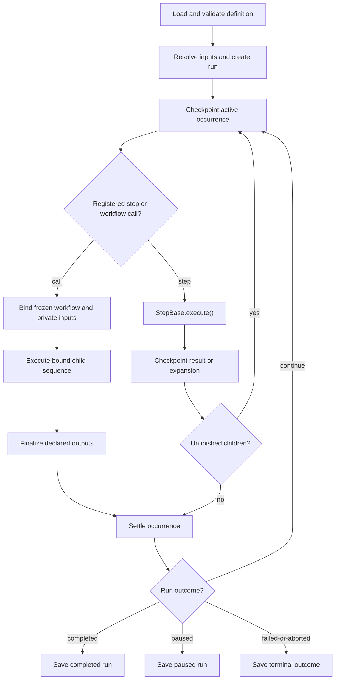
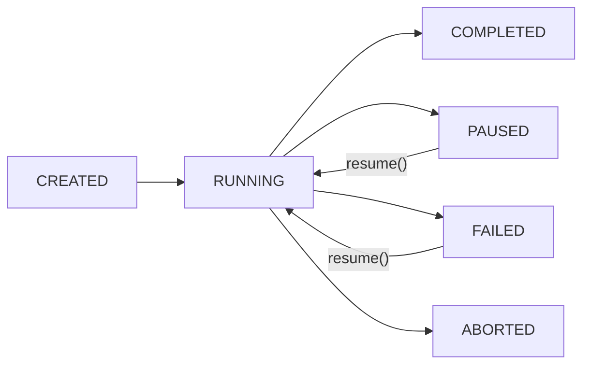

# 工作流程 API 參考

本參考說明工作流程 YAML，以及執行與狀態語義。CLI 的 JSON 執行、狀態與定義介面記載於命令參考。

## 工作流程 YAML 結構描述

| 欄位 | 合約 |
| --- | --- |
| `schema_version` | 版本 `1.0`；省略時預設為 `1.0` |
| `workflow` | 中繼資料與分派預設值 |
| `workflow.id` | 小寫字母／數字／連字號，開頭與結尾須為字母或數字；單一字元 ID 有效 |
| `workflow.name` | 必填的非空白字串 |
| `workflow.version` | `X.Y.Z` 形式的字串；省略時預設為 `0.0.0` |
| `workflow.author`、`workflow.description` | 描述性中繼資料 |
| `workflow.integration`、`workflow.model` | 可選的字串／null 分派預設值 |
| `workflow.reasoning_effort`、`workflow.context_size` | `command` 與 `prompt` 步驟的可選字串／null 分派預設值；字面值必須遵循[值規則](../workflow-steps/types.md#推理強度與上下文大小) |
| `workflow.options` | 預設命令步驟 `options` 的可選對應／null；記錄於步驟輸出中，不會傳給整合 CLI |
| `requires` | 僅接受 `speckit_version` 與 `integrations` 的可選對應 |
| `inputs` | 輸入定義的對應 |
| `outputs` | 已宣告工作流程呼叫輸出的對應 |
| `steps` | 步驟定義的非空白清單 |

`requires` 僅供參考，不是沙箱或執行期權限關卡。未知鍵（包括 `requires.permissions`）會被拒絕。工作流程預設值不會跨越工作流程呼叫邊界；子工作流程需要時，請明確對應輸入。

每個輸出都會宣告一個 `value` 運算式。工作流程呼叫結果只會公開已宣告的 JSON 安全值，以及引擎擁有的狀態欄位，不會公開子輸入、內部步驟記錄或日誌。

## 輸入類型

工作流程輸入會進行類型檢查，並從 CLI 字串值強制轉換：

```yaml
inputs:
  spec:
    type: string
    required: true
    prompt: "Describe what you want to build"
  task_count:
    type: number
    default: 5
  dry_run:
    type: boolean
    default: false
  scope:
    type: string
    default: "full"
    enum: ["full", "backend-only", "frontend-only"]
```

| 類型 | 接受 | 範例 |
|------|---------|---------|
| `string` | 任何字串 | `"user-auth"` |
| `number` | 數字字串 → int/float | `"42"` → `42` |
| `boolean` | `true`/`1`/`yes` → `True`，`false`/`0`/`no` → `False` | `"true"` → `True` |

數字輸入會精確保留整數值與整數字串，包括超過 `2**53` 的值。小數／指數字串會使用浮點數轉換，結果為整數值時會以整數儲存。布林值、非數值與非有限數字會被拒絕。必填輸入必須提供或提示輸入；預設值與列舉成員資格會經過驗證。

## 執行模型

呼叫 `specify workflow run` 時，它會載入並驗證定義、解析輸入，然後執行根序列。已註冊的步驟與工作流程呼叫共用發生點生命週期處理：



### 循序執行

步驟循序執行。每個步驟都會收到一個 `StepContext`，其中包含已解析的輸入、累積的步驟結果，以及工作流程層級的預設值。執行後，步驟的輸出會儲存在 `context.steps[step_id]` 中，並透過如 `{{ steps.specify.output.file }}` 的運算式提供給後續步驟。

### 巢狀步驟（控制流程）

`if`、`switch`、`while` 與 `do-while` 等步驟會傳回 `next_steps`：引擎會將其記錄為子發生點的內嵌定義。一般的巢狀分支會共用周圍的運算式內容。扇出項目則有獨立的內容，而工作流程呼叫會繫結私有輸入與預設值；其內部別名不會進入呼叫者的內容。

### 狀態持久化與續跑

引擎會將步驟進度檢查點寫入磁碟，讓中斷的工作可以繼續：



當 `gate` 暫停執行時，引擎會保留輸入與步驟結果。執行 `specify workflow resume <run_id>` 時，已完成的發生點會重播到其內容中，而不再次執行，然後繼續未完成的工作。

選取的展開與工作流程繫結會在其子副作用之前儲存，結果則在工作標示完成之前儲存。檢查點失敗會停止執行，而非在沒有持久進度的情況下繼續。步驟會透過[公開步驟 API](../workflow-steps/api.md)傳回結果或巢狀定義；它們不管理檢查點轉換，也不編輯私有的執行狀態。

## 執行身分與繼續

每個步驟發生點在保存的執行樹中擁有一個記錄。撰寫的步驟 ID 是本地運算式別名，而非全域執行 ID。扇出項目有獨立的別名內容與有序的項目結果。公開回報在需要時使用限定發生 ID，例如扇出項目為 `fan:template:0`，後續迴圈迭代為 `loop:step:1`。限定 ID 不是運算式名稱。扇出項目別名僅供回報：`fan-in` 的
`wait_for` 參照宣告的步驟 ID，特別是扇出步驟自身的
`id`，其有序項目結果可透過
`steps.<fan-out-id>.output.results` 取得。

> **移轉注意：** 扇出的輸出不再包含 `step_template`。
> `steps.<fan-out-id>.output` 以及扇出在 `fan-in` 的
> `output.results` 中的項目，包含 `items`、`max_concurrency`、`item_count` 與
> `results`；範本只保留在執行項目的私有執行樹中。
> 諸如 `{{ steps.<fan-out-id>.output.step_template }}` 的運算式
> 現在會解析為空白。請改從工作流程定義中扇出的 `step` 讀取範本。

新的執行會保存選取的分支、動態自訂步驟展開、迴圈迭代與扇出項目。繼續會保留已完成的工作，而不重新求值已選取的分支。即使安裝內容變更，工作流程目標與覆疊解析後的定義仍保持繫結。未繫結的呼叫在執行到達時，仍會檢查其目標是否已安裝且已啟用。

一般繼續會保留已繫結的輸入。明確的 `--input` 會透過其原始對應，重新繫結已到達的未完成呼叫：新對應的值會覆寫先前的繫結，而未再次對應的值則保留其已繫結值。已完成的呼叫會保留其結果。輸出求值失敗只會重試定案，而不重複已完成的子命令。

快照會保留工作流程定義的 YAML 純量類型。輸入與結果仍為 JSON 值。快照會凍結定義與展開，而非 `context.workflow_dir` 下的檔案或步驟實作；缺失的資源仍可能造成一般的步驟失敗。舊執行會從其已儲存的進度繼續。繼續僅適用於處於 `paused` 或 `failed` 狀態的執行。

`current_step_index` 是根序列索引；`current_step_id` 是隨著步驟進入而更新的相容性發生點 ID 檢視。它不是精確的作用中步驟集合：在平行扇出期間，它可能指向已完成的項目。限定值包括扇出項目的 `fan:item:0` 與後續迴圈迭代的 `loop:body:1`。在工作流程呼叫內部，ID 相對於被呼叫的工作流程。結構化的執行／狀態輸出在呼叫存在時會包含 `workflow_scopes` 摘要，並以其 `scope_path` 回報作用中的巢狀關卡。請使用 [CLI 的結構化狀態與定義介面](cli.md#工作流程狀態)檢查進度，而不要依賴私有日誌欄位或執行樹內部。

## 錯誤處理

預設情況下，任何在執行期回傳 `StepResult(status=StepStatus.FAILED, ...)`
的步驟都會中止整個執行 — 最常見的是 `shell` 或
`command` 步驟以非零狀態結束。在
步驟上設定 `continue_on_error: true`，可記錄其結果並繼續到下一個同層步驟
，而不是中止。當失敗是來自非零結束時，結束代碼
仍可透過 `steps.<id>.output.exit_code` 取得，讓下游的
`if` 或 `switch` 能依此分支（或讓 `gate` 透過 `message` 中的 `{{ }}` 插值將它呈現給
操作者）：

```yaml
- id: heavy-thing
  type: command
  integration: claude
  command: speckit.heavy-thing
  continue_on_error: true

- id: check-result
  type: if
  condition: "{{ steps.heavy-thing.output.exit_code != 0 }}"
  then:
    - id: review
      type: gate
      message: "Step failed (exit {{ steps.heavy-thing.output.exit_code }}). Approve to run the recovery path, or reject to leave the failure recorded and move on."
      on_reject: skip
    - id: recover
      type: if
      condition: "{{ steps.review.output.choice == 'approve' }}"
      then:
        - id: rerun
          command: speckit.recovery
  else:
    - id: next-thing
      command: speckit.next-thing
```

關於這個例子，有幾點值得了解：

- 兩個關卡選項（`approve`、`reject`）都回傳 `StepStatus.COMPLETED`；
  `on_reject: skip` 只控制引擎是否在拒絕時中止
  （使用 `skip` 時不會中止）— 它**不會**自動略過 `then:` 清單中後續的
  同層步驟。下游分支是
  工作流程作者的責任：在後續的 `if`、`switch`
  或運算式中讀取 `{{ steps.<gate-id>.output.choice }}`，如上例的 `recover` 步驟所示。
- `on_reject` 有三個值：`abort`（預設 — 拒絕 → `StepStatus.FAILED`
  並帶有 `output.aborted = True`，中止執行）、`skip`（拒絕 →
  `StepStatus.COMPLETED`，由作者如上所示處理分支），以及 `retry`
  （拒絕 → `StepStatus.PAUSED`，讓下一次 `specify workflow resume` 重新執行
  該關卡）。
- 關卡不會自動重新執行失敗的步驟。要表達
  重試路徑，可以定義自訂關卡選項並在下游依
  選擇分支，或將失敗的步驟包在你自己的迴圈中。

**注意事項：**

- 該欄位必須是字面布林值（`true`／`false`）；驗證時會拒絕被強制轉換的字串，例如 `"true"`。
- **範圍：僅限傳回的失敗**。此旗標僅適用於 `status=StepStatus.FAILED` 的步驟結果。步驟的 `execute()` 方法所引發、未處理的例外，會由引擎回報並中止執行，不受 `continue_on_error` 影響。若步驟作者希望旗標涵蓋例外路徑，步驟必須在內部捕捉例外，並傳回 `StepResult(status=StepStatus.FAILED, ...)`，將失敗編碼於 `output` 中（例如 `exit_code`、`stderr` 或自訂欄位）。
- 關卡中止（操作者選擇的 `on_reject: abort`）一定會停止執行——`continue_on_error` 無法覆寫它們。此旗標適用於暫時性／預期的步驟失敗，而非覆寫刻意的操作者決定。
- 結構驗證會預先執行：`specify workflow run` 會在建立執行之前拒絕無效的工作流程定義，因此驗證失敗永遠不會進入此程式碼路徑。
- 省略此旗標或設為 false 時，傳回的失敗會停止執行。

## 狀態與繼續

每次工作流程執行都會將其狀態保存於 `.specify/workflows/runs/<run_id>/`：

- `state.json`——目前的執行狀態與步驟進度，包括每個步驟的輸出。使用 [`capture: true`](../workflow-steps/types.md#擷取命令與提示詞輸出) 擷取的輸出會以純文字儲存在此處。
- `inputs.json`——已解析的輸入值
- `log.jsonl`——逐步執行日誌

這讓 `specify workflow resume` 可以重播已完成的發生點，並在執行暫停（例如在關卡處）或失敗的未完成發生點繼續。

## 狀態與設定位置

| 元件 | 位置 | 格式 | 用途 |
|-----------|----------|--------|---------|
| 工作流程定義 | `.specify/workflows/{id}/workflow.yml` | YAML | 已安裝的工作流程定義 |
| 工作流程註冊表 | `.specify/workflows/workflow-registry.json` | JSON | 已安裝工作流程的中繼資料 |
| 專案覆疊 | `.specify/workflows/overlays/{id}/*.yml` | YAML | 專案本地的工作流程編輯 |
| 執行狀態 | `.specify/workflows/runs/{run_id}/state.json` | JSON | 持久化的執行狀態 |
| 執行輸入 | `.specify/workflows/runs/{run_id}/inputs.json` | JSON | 已解析的輸入值 |
| 執行日誌 | `.specify/workflows/runs/{run_id}/log.jsonl` | JSONL | 僅附加的事件日誌 |
| 型錄快取 | `.specify/workflows/.cache/*.json` | JSON | 快取的型錄項目（1 小時 TTL） |
| 專案型錄 | `.specify/workflow-catalogs.yml` | YAML | 專案層級的型錄來源 |
| 使用者型錄 | `~/.specify/workflow-catalogs.yml` | YAML | 使用者層級的型錄來源 |

## 另請參閱

- [工作流程 CLI 與 JSON 合約](cli.md)
- [撰寫與隨附範例](developing.md)
- [Built-in step configuration](../workflow-steps/types.md)
- [Expressions](expressions.md)
- [Catalog schemas](catalogs.md)
- [步驟 Python API 參考](../workflow-steps/api.md)
