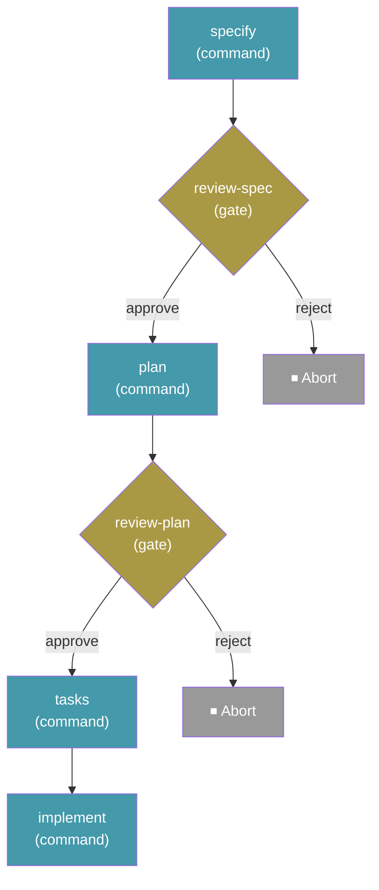

# 開發工作流程

工作流程套件包含一個 `workflow.yml` 定義，以及它參照的任何指令碼、模組或資源。先從小的本地定義開始，練習成功與失敗路徑，再封裝為版本化的發行版本。

## 套件配置

```text
my-workflow/
├── workflow.yml
├── README.md
├── LICENSE
├── CHANGELOG.md
└── scripts/
```

單一裸 YAML 檔案就足以應付簡單的工作流程。目錄與封存檔安裝會保留附屬檔案；原始 YAML URL 不會下載相鄰的儲存庫檔案。封存檔可以在其根目錄，或在單一頂層目錄內包含套件。

請使用 `context.workflow_dir` 或 shell 的 `SPECKIT_WORKFLOW_DIR` 解析附屬檔案，而非呼叫者的工作目錄。

## 隨附的 SDD 範例

工作流程以 YAML 檔案定義。以下是 Spec Kit 隨附的內建**完整 SDD 循環**工作流程：

```yaml
schema_version: "1.0"
workflow:
  id: "speckit"
  name: "Full SDD Cycle"
  version: "1.0.2"
  author: "GitHub"
  description: "Runs specify → plan → tasks → implement with review gates"

requires:
  speckit_version: ">=0.15.1"
  integrations:
    any:
      - "alquimia"
      - "claude"
      - "copilot"
      - "gemini"
      - "opencode"

inputs:
  spec:
    type: string
    required: true
    prompt: "Describe what you want to build"
  integration:
    type: string
    default: "auto"
    prompt: "Integration to use (e.g. claude, copilot, gemini; 'auto' uses the project's initialized integration)"
  speckit_review_spec_verdict:
    type: string
    default: ""
  speckit_review_plan_verdict:
    type: string
    default: ""

steps:
  - id: specify
    command: speckit.specify
    integration: "{{ inputs.integration }}"
    input:
      args: "{{ inputs.spec }}"

  - id: review-spec
    type: gate
    verdict_input: speckit_review_spec_verdict
    message: "Review the generated spec before planning."
    options: [approve, reject]
    on_reject: abort

  - id: plan
    command: speckit.plan
    integration: "{{ inputs.integration }}"
    input:
      args: "{{ inputs.spec }}"

  - id: review-plan
    type: gate
    verdict_input: speckit_review_plan_verdict
    message: "Review the plan before generating tasks."
    options: [approve, reject]
    on_reject: abort

  - id: tasks
    command: speckit.tasks
    integration: "{{ inputs.integration }}"
    input:
      args: "{{ inputs.spec }}"

  - id: implement
    command: speckit.implement
    integration: "{{ inputs.integration }}"
    input:
      args: "{{ inputs.spec }}"
```

這會產生以下執行流程：



執行方式：

```bash
specify workflow run speckit -i spec="Build a kanban board with drag-and-drop task management"
```

## 本機測試

```bash
specify workflow run ./workflow.yml --input key=value
specify workflow status <run_id>
specify workflow resume <run_id>
specify workflow add ./my-workflow --dev
specify workflow info my-workflow
```

`run` 會在執行前驗證，然後執行定義；它不是試跑驗證器。請使用可拋棄的已初始化專案，來練習可能修改檔案或呼叫代理的範例。沒有 `specify workflow validate` 命令。`info` 會顯示中繼資料與步驟，而非完整的安全審查。

請涵蓋有效與無效輸入、關卡判定與拒絕政策、步驟失敗、中斷／失敗的繼續、巢狀呼叫，以及適用的並行項目。已完成的步驟在繼續時不會重複，但未建立檢查點的副作用可能會重複；請讓外部寫入可安全重試。

## 撰寫實務

- 保持步驟聚焦，並在有意義的決策點放置關卡。
- 為輸入提供描述性的提示詞、適當的類型、合理的預設值，以及固定選項的列舉。
- 宣告整合預設值，並允許逐步驟覆寫。`requires.integrations` 記載的是預期，而非強制執行的權限。
- 只有在先前步驟已執行後，才讀取其輸出；`default` 會處理 null 或空白文字，而非所有可能的運算式錯誤。
- 動態資料請優先使用帶有環境繫結的嚴格 shell 步驟。請記載破壞性操作、憑證、網路呼叫與其他副作用。關卡不會讓不受信任的 shell 文字變得安全。

## 另請參閱

- [工作流程 YAML 與執行語義](api.md)
- [Built-in step types](../workflow-steps/types.md)
- [運算式與 shell 安全](expressions.md)
- [Publishing workflows](publishing.md)
- [開發自訂步驟套件](../workflow-steps/developing.md)
