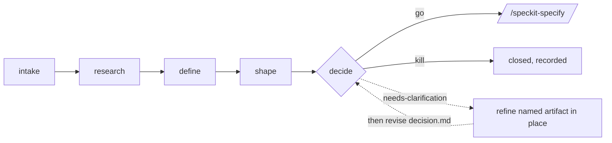

# 構想評估管線擴充功能

這是 Spec Kit 的五階段評估管線，能在構想進入規格驅動開發之前，把**任何構想**轉化為站得住腳的 **go／needs-clarification／kill** 決策。它正是缺少的那條**探索軌道**，位於 SDD **交付軌道**（`specify → clarify → plan → tasks → analyze → implement`）之前。

探索回答的是「*這值得做嗎？*」，交付回答的是「*我們要怎麼做？*」。只有通過評估的構想才會交接給 `/speckit-specify`。

## 總覽

`assess` 在已初始化的 Spec Kit 專案中執行（它把評估寫入 `.specify/assessments/`），但該專案可以**完全沒有原始碼**——剛初始化、沒有任何程式碼的專案，和成熟的程式碼庫一樣適用。輸入只是一個構想：貼上的文字、URL 或工單都不需要既有程式碼；而程式碼庫指標則讓你能針對已存在的程式碼評估構想。兩種起點沒有哪一個比較「正確」。

每個構想都放在 `.specify/assessments/<slug>/` 下自己的目錄中，每個階段一份 Markdown 產出物：

```
.specify/assessments/<slug>/
├── intake.md      # /speckit-assess-intake   — 擷取原始構想
├── research.md    # /speckit-assess-research — 蒐集證據（並用證據挑戰構想）
├── problem.md     # /speckit-assess-define   — 定義問題、目標、指標
├── concept.md     # /speckit-assess-shape    — 塑造解決方案選項與胃納量
└── decision.md    # /speckit-assess-decide   — go / needs-clarification / kill → 交接
```

這條管線是一個**漏斗**：大多數構想應該在 `shape` 之前就被否決或擱置。以有記錄的理由否決一個構想，是成功的結果，而不是失敗。



## 命令

本 README 中的斜線命令使用 GitHub Copilot 的預設 skills 語法。
若使用其他代理，請改用它的
[等效呼叫語法](https://github.github.io/spec-kit/integrations/cli.html#command-invocation)。

| Command | 階段 | 輸出 |
|---------|-------|--------|
| `/speckit-assess-intake` | 擷取並正規化原始構想（文字、URL、工單或程式碼庫指標）。 | `intake.md` |
| `/speckit-assess-research` | 蒐集使用者／市場／先行做法／資料方面的證據——以及*反對*該構想的證據。 | `research.md` |
| `/speckit-assess-define` | 定義問題：使用者、目標、非目標、成功指標、不行動的代價。 | `problem.md` |
| `/speckit-assess-shape` | 塑造 2～3 個概念層級的選項，附胃納量與取捨；推薦其中一個（或都不推薦）。 | `concept.md` |
| `/speckit-assess-decide` | 依準則評分並做出判定；把 `go` 的構想交給 `/speckit-specify`。 | `decision.md` |

各階段設計上依序執行，但並非嚴格設卡：

- `define` 是最小可行的階段，可直接以使用者輸入執行（intake／research 為選用）。
- `shape` 需要 `problem.md`。
- `decide` 需要 `problem.md`；`go` 判定預期要有 `concept.md`（否則會降級為 `needs-clarification`）。

## 解決釐清事項

正常流程是循序進行的，每個命令通常只執行**一次**：

```text
intake → research → define → shape → decide
```

每個階段都會在 `.specify/assessments/<slug>/` 下寫入一份 Markdown 產出物。這些檔案保持可編輯。命令會保留既有的輸出範本：它們不會重寫先前的產出物，也不會自己執行那種精煉。`[NEEDS CLARIFICATION: …]` 標記是產出物中的缺口，不是從頭重新產生整個階段的訊號。

請透過精煉既有檔案來解決它們：

1. **直接編輯 Markdown**（填入缺少的指標、負責人、限制條件等），或
2. **在自由形式的聊天中請代理**把缺少的資訊納入該產出物。

接著詢問新資訊是否已解除阻礙，並更新任何依賴它的下游文字。這也包括 `decision.md`：你可以提供缺少的事實，請代理修訂評分表、理由、判定或交接內容。這是產出物精煉，不是命令迭代。

加入證據時，請保留 research 階段已在使用的來源與信心標籤（`ASSUMPTION` 與有引用的主張）。不要捏造引用。

重新執行較早的評估命令屬於例外情況（例如 slug 錯誤或草稿已捨棄之後），不是回應釐清標記的預設路徑。

## Slug 慣例

*slug* 是 `.specify/assessments/` 下每個構想的目錄名稱。它是五個命令共用的識別代號。

- **使用者提供**：正規化為小寫 kebab-case（例如 `offline-mode`、`cut-onboarding-friction`）。正規化後逐字保留——不附加時間戳記或編號。
- **主動詢問**：在互動使用中，若未提供 slug，`/speckit-assess-intake` 會詢問，並建議一個由構想衍生的 kebab-case 預設值。
- **自動產生**：當沒有人可詢問時，代理會產生唯一的 slug，且絕不覆寫既有的評估目錄（必要時附加 `-2`、`-3`、……或簡短日期）。
- **從上下文重用**：後續階段重用同一工作階段稍早回報的 slug，並以評估目錄是否存在來確認。

## 安裝

```bash
specify extension add assess
```

## 停用

```bash
specify extension disable assess
specify extension enable assess
```

## 典型流程

在你的代理聊天中（而非終端機）執行這些 skills，一次一個，
在繼續之前先檢視每個結果。

本範例使用 GitHub Copilot 的預設 skills 語法。若使用其他代理，
請改用它的[等效呼叫語法](https://github.github.io/spec-kit/integrations/cli.html#command-invocation)。

```text
# 1. Capture an idea (pasted text, a URL, or "assess this repo")
/speckit-assess-intake "Let users work offline and sync when they reconnect" slug=offline-mode

# 2. Gather evidence — and reasons it might not be worth it
/speckit-assess-research slug=offline-mode

# 3. Define the actual problem
/speckit-assess-define slug=offline-mode

# 4. Shape 2–3 concept options with appetites
/speckit-assess-shape slug=offline-mode

# 5. Decide — go, clarify, or kill
/speckit-assess-decide slug=offline-mode
# → on "go", optionally pass the decision.md handoff summary to /speckit-specify
```

## 交接

`assess` 是一條**你刻意進入的獨立管線**——它不註冊任何生命週期 hook，也絕不會把自己插入 `/speckit-specify`。唯一的耦合是向前且出於選擇：`/speckit-assess-decide` 的 `go` 判定會把它的 `decision.md` 摘要交給 `/speckit-specify`。探索與規格制定維持為各自獨立的流程。

## 防護措施

- 只有五個評估命令會寫入，且只寫入 `.specify/assessments/<slug>/` 內。**它們都不會修改原始碼**——解決方案設計與實作屬於 SDD 生命週期（從 `/speckit-specify` 開始）。
- 在 `intake`／`research` 期間擷取的網路內容會被視為不受信任的資料，並受明確的 URL Trust Policy 約束（允許清單中的公開來源可自由擷取；未知主機會提示或跳過；loopback／RFC1918／中繼資料端點一律拒絕）。
- 證據絕不誇大：沒有出處的陳述會標記為 `ASSUMPTION`，且 `research.md` 一律包含 *Evidence Against the Idea* 區段。
- 判定絕不誇大：`go` 需要有效的問題、`adequate` 以上的證據（絕不能是 weak／unknown），以及已塑造的概念；否則誠實的判定是 `needs-clarification`。
- Slug 會正規化為 `[a-z0-9-]`，空結果會被拒絕；在任何讀取或寫入之前，每個命令也會拒絕符號連結的路徑組成部分，並驗證解析後的路徑仍位於專案根目錄內——因此即使在經刻意構造或複製的專案中，評估也絕不可能逃出 `.specify/assessments/`。
- 任何命令都不會在未經確認的情況下覆寫既有產出物；在自動化模式下會直接拒絕。

## 與其他擴充功能的關係

`assess` 刻意設計為**通用、角色中立**的探索軌道——創辦人、PM、BA、工程師或設計師都能使用。社群型錄中更豐富或更專門的 SDD 前置流程（例如 product-lifecycle orchestrators、technical-discovery、intake-normalization、brownfield onboarding）可以疊加在它之上，或把成果餵給它；`assess` 的目標是成為最小、最有主張的漏斗，乾淨地止於 `/speckit-specify` 交接點。
