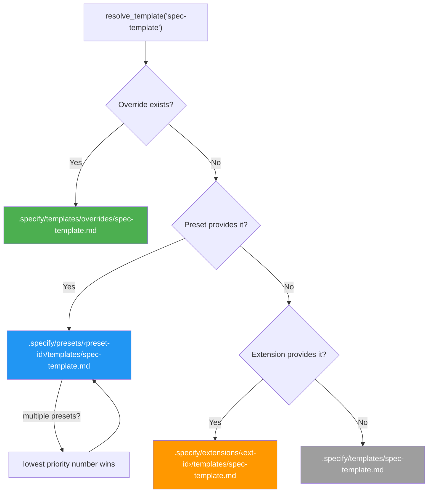
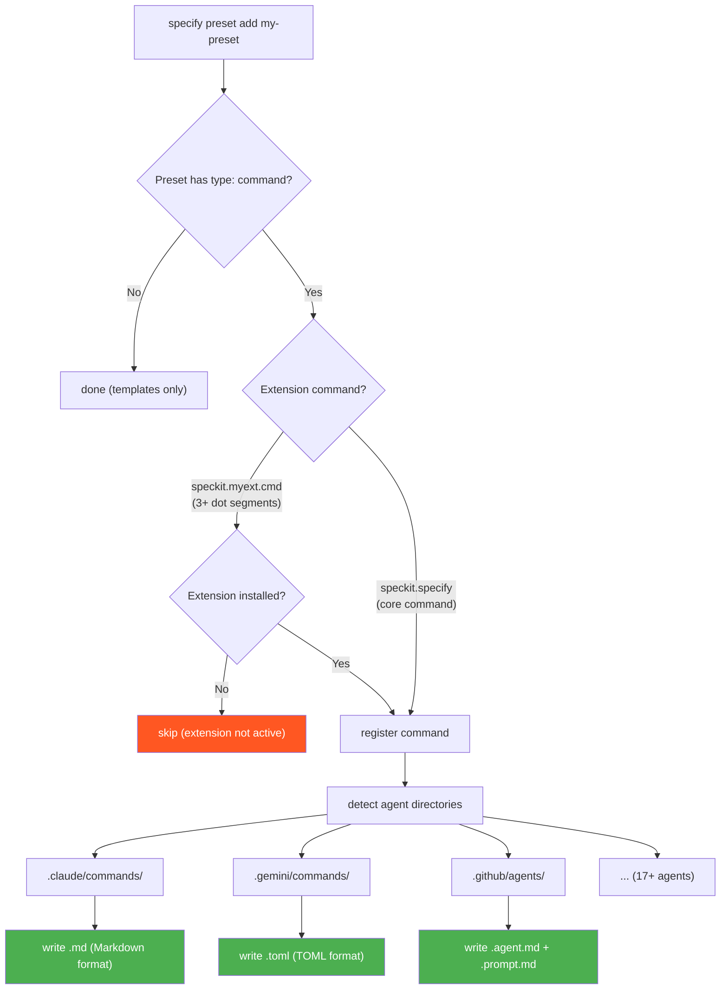
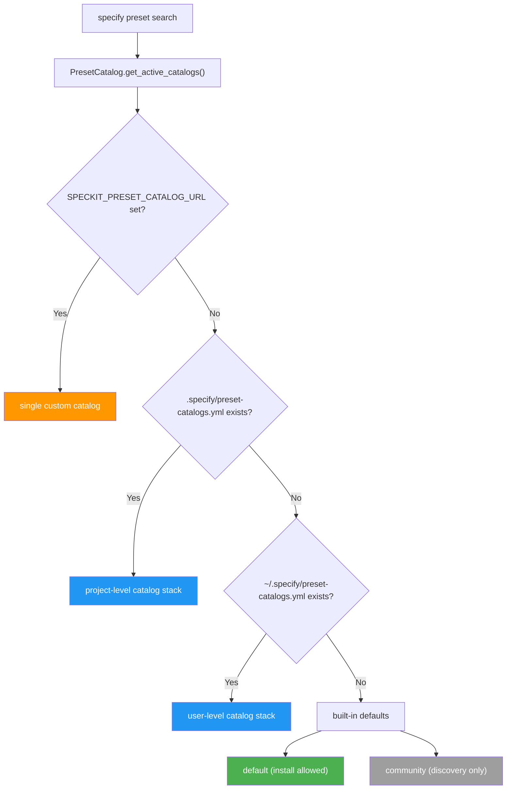

# 預設集系統架構

本文件說明預設集系統的內部架構 — 範本解析、命令註冊與目錄管理在幕後如何運作。

使用說明請參閱 [README.md](README.md)。

## 範本解析

當 Spec Kit 需要一個範本（例如 `spec-template`）時，`PresetResolver` 會走訪一個優先級堆疊，並回傳第一個相符項：



| 優先級 | 來源 | 路徑 | 使用情境 |
|----------|--------|------|----------|
| 1（最高） | Override | `.specify/templates/overrides/` | 一次性的專案本機微調 |
| 2 | Preset | `.specify/presets/<id>/templates/` | 可分享、可堆疊的自訂設定 |
| 3 | Extension | `.specify/extensions/<id>/templates/` | 擴充功能提供的範本 |
| 4（最低） | Core | `.specify/templates/` | 隨附的預設值 |

當安裝多個預設集時，它們會依其 `priority` 欄位排序（數字越小 = 優先級越高）。這是透過 `specify preset add` 的 `--priority` 設定的。

這套解析邏輯實作了三次，以確保一致性：

- **Python**：`src/specify_cli/presets.py` 中的 `PresetResolver`
- **Bash**：`scripts/bash/common.sh` 中的 `resolve_template()`
- **PowerShell**：`scripts/powershell/common.ps1` 中的 `Resolve-Template`

### 組成策略

範本、命令與指令碼支援一個 `strategy` 欄位，控制預設集的內容如何與優先級較低的內容組合，而不是完全取代它：

| 策略 | 說明 | 範本 | 命令 | 指令碼 |
|----------|-------------|-----------|----------|---------|
| `replace`（預設） | 完全取代優先級較低的內容 | ✓ | ✓ | ✓ |
| `prepend` | 將內容放在優先級較低的內容之前（以空行分隔） | ✓ | ✓ | — |
| `append` | 將內容放在優先級較低的內容之後（以空行分隔） | ✓ | ✓ | — |
| `wrap` | 內容包含 `{CORE_TEMPLATE}`（範本／命令）或 `$CORE_SCRIPT`（指令碼）佔位符，會被優先級較低的內容取代 | ✓ | ✓ | ✓ |

組成是遞迴的 — 多個組成中的預設集會串連。`PresetResolver.resolve_content()` 方法會由下而上走訪完整的優先級堆疊，並套用每一層的策略。

用於組成的內容解析函式：

- **Python**：`src/specify_cli/presets.py` 中的 `PresetResolver.resolve_content()`（範本、命令與指令碼）
- **Bash**：`scripts/bash/common.sh` 中的 `resolve_template_content()`（僅範本；命令／指令碼的組成由 Python 解析器處理）
- **PowerShell**：`scripts/powershell/common.ps1` 中的 `Resolve-TemplateContent`（僅範本；命令／指令碼的組成由 Python 解析器處理）

### 憲章生命週期

初始化會透過完整堆疊解析 `constitution-template`，並植入
`.specify/memory/constitution.md` 一次。既有檔案會逐位元組保留。在後續的
`/constitution` 執行中，命令會在執行期解析目前組成的範本，並使用即時
憲章作為專案專屬值與修訂的來源。

預設集的安裝、移除、啟用、停用與優先級變更，預設不會具體化
`constitution-template`。當啟用的預設集註冊表包含 `constitution-sync` 時，
這些操作可能對即時檔案進行對帳，但前提是其來源雜湊證明它仍是
已產生的內容。檔案遺失時，可以在安裝預設集時植入；已撰寫或已編輯的
憲章永遠不會被覆寫。

## 命令註冊

當預設集以 `type: "command"` 項目安裝時，`PresetManager` 會使用 `src/specify_cli/agents.py` 中共用的 `CommandRegistrar`，將它們註冊到所有偵測到的代理目錄。



### 擴充功能安全檢查

命令名稱遵循 `speckit.<ext-id>.<cmd-name>` 模式。當命令有 3 個以上的點分隔區段時，系統會擷取擴充功能 ID，並檢查 `.specify/extensions/<ext-id>/` 是否存在。若擴充功能未安裝，該命令會被略過 — 避免產生參照不存在擴充功能的孤立檔案。

核心命令（例如只有 2 個區段的 `speckit.specify`）一律會註冊。

### 代理格式渲染

`CommandRegistrar` 會依代理以不同方式渲染命令：

| 代理 | 格式 | 副檔名 | 參數佔位符 |
|-------|--------|-----------|-----------------|
| Claude、Kilo Code、opencode 等 | Markdown | `.md` | `$ARGUMENTS` |
| Copilot | Markdown | `.agent.md` + `.prompt.md` | `$ARGUMENTS` |
| Gemini、Qwen、Tabnine | TOML | `.toml` | `{{args}}` |

### 移除時清理

當呼叫 `specify preset remove` 時，會從註冊表中繼資料讀取已註冊的命令，並從每個代理目錄刪除對應檔案，包括 Copilot 的附屬 `.prompt.md` 檔案。

## 目錄系統



目錄以 1 小時快取擷取（依 URL 區分、經 SHA256 雜湊的快取檔案）。每個目錄項目都有一個 `priority`（用於合併排序）與 `install_allowed` 旗標。

## 儲存庫佈局

```text
presets/
├── ARCHITECTURE.md                         # This file
├── PUBLISHING.md                           # Guide for submitting presets to the catalog
├── README.md                               # User guide
├── catalog.json                            # Official preset catalog
├── catalog.community.json                  # Community preset catalog
├── scaffold/                               # Scaffold for creating new presets
│   ├── preset.yml                          # Example manifest
│   ├── README.md                           # Guide for customizing the scaffold
│   ├── commands/
│   │   ├── speckit.specify.md              # Core command override example
│   │   └── speckit.myext.myextcmd.md       # Extension command override example
│   └── templates/
│       ├── spec-template.md                # Core template override example
│       └── myext-template.md               # Extension template override example
└── self-test/                              # Self-test preset (overrides all core templates)
    ├── preset.yml
    ├── commands/
    │   └── speckit.specify.md
    └── templates/
        ├── spec-template.md
        ├── plan-template.md
        ├── tasks-template.md
        ├── checklist-template.md
        └── constitution-template.md
```

## 模組結構

```text
src/specify_cli/
├── agents.py       # CommandRegistrar — shared infrastructure for writing
│                    #   command files to agent directories
├── presets.py       # PresetManifest, PresetRegistry, PresetManager,
│                    #   PresetCatalog, PresetCatalogEntry, PresetResolver
└── __init__.py      # CLI commands: specify preset list/add/remove/search/
                     #   resolve/info, specify preset catalog list/add/remove
```
