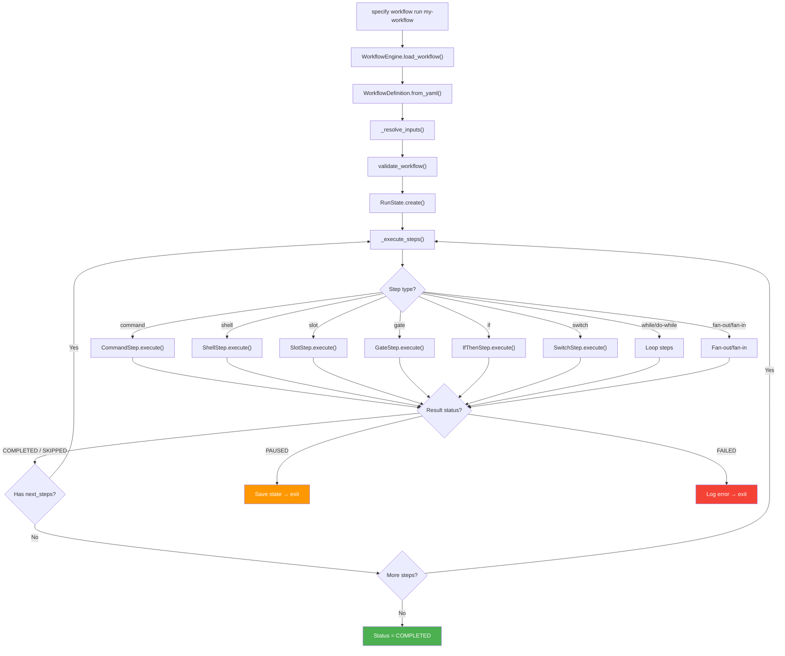
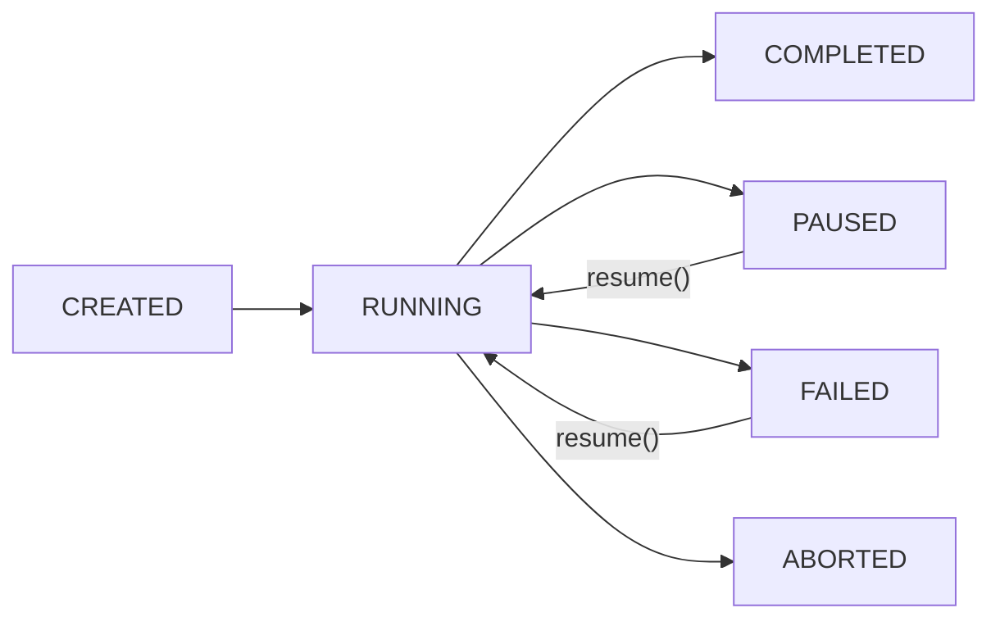
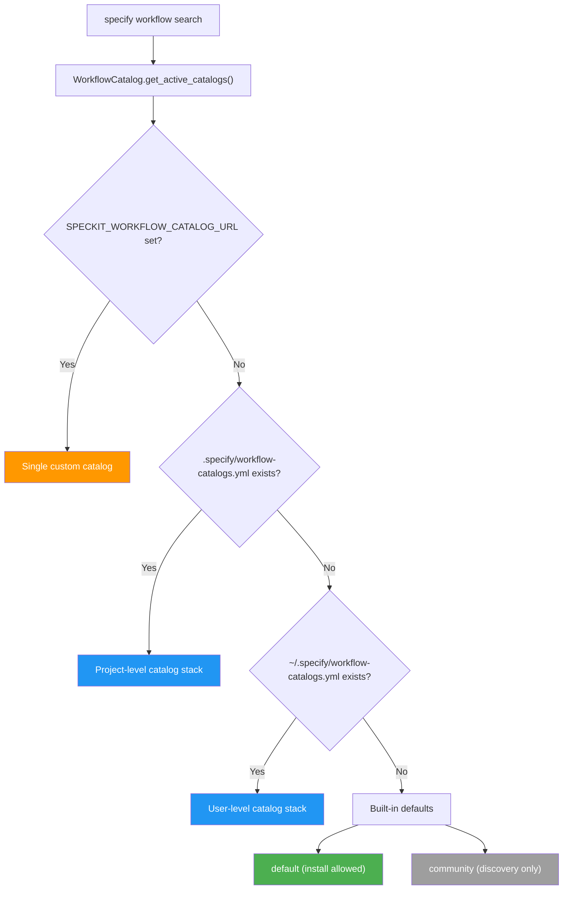

# 工作流程系統架構

本文件說明工作流程引擎的內部架構 — 定義如何被解析、步驟如何被分派、狀態如何被持久化，以及目錄如何被解析。

使用說明請參閱 [README.md](README.md)。

## 執行模型

當呼叫 `specify workflow run` 時，引擎會載入一份 YAML 定義、解析輸入，並透過步驟註冊表循序分派步驟：



### 循序執行

步驟循序執行。每個步驟都會收到一個 `StepContext`，其中包含已解析的輸入、累積的步驟結果，以及工作流程層級的預設值。執行後，步驟的輸出會儲存在 `context.steps[step_id]` 中，並透過如 `{{ steps.specify.output.file }}` 的運算式提供給後續步驟。

### 巢狀步驟（控制流程）

`if`、`switch`、`while` 與 `do-while` 等步驟會回傳 `next_steps` — 引擎透過 `_execute_steps()` 遞迴執行的內嵌步驟定義。巢狀步驟共用同一個 `StepContext` 與 `RunState`，因此它們的輸出對後續的頂層步驟可見。

### 狀態持久化與續跑

引擎會在每個步驟後將 `RunState` 儲存到磁碟，讓執行能從確切的中斷點續跑：



當 `gate` 步驟暫停執行時，引擎會持久化 `current_step_index`
與所有累積的 `step_results`。在 `specify workflow resume <run_id>` 時，
同一個執行器會將已完成的出現次數重播到它們的脈絡中，而不
重新執行它們，然後在未完成的出現次數處繼續。

新的執行使用有版本的執行樹。每個出現次數都擁有自己的結果、
所選的子序列，以及選擇性的工作流程綁定。綁定會儲存
目標、凍結的定義、私人輸入與 `workflow_dir`；被呼叫的
工作流程在同一次執行中仍是一個私人範圍。扇出項目有各自獨立的
脈絡。每個出現次數，包括工作流程呼叫，都會在記錄其開始之前、以及在它執行之前，被檢查點為
作用中的步驟，因此狀態會在它執行時回報它。綁定與所選的展開會在
子副作用之前被檢查點，結果會在出現次數完成之前，
而日誌會在檢查點之後。
舊有執行只會透過其頂層索引進入一次。輸入與樹的
轉換共用一個原子狀態檢查點；輸入檔案是
相容性鏡像。檢查點失敗會阻止該
執行器實例進一步寫入。

### 出現次數生命週期

`Execution.step()` 是已註冊步驟與工作流程呼叫的共同執行器。
`execute_step()` 與 `workflow()` 會回傳一個 `StepResult`、子樹結果，或
未知的實作失敗。只有執行器會在例外展開時執行 `begin`、`finish`、
`settle`，以及盡力而為的 `leave`；`transition()` 中的階段與欄位
允許清單會拒絕無效的操作。公開、無狀態的
`StepBase.execute()` 擴充契約維持不變。

所有出現次數的變更都通過 `Execution.transition()`。它會檢查
允許的來源階段與欄位、推導目標階段、以載入時使用的相同節點規則驗證
候選者、投影結果，並在執行鎖下儲存。呼叫者不能提供目標階段。

| 操作 | 意義 |
|-----------|---------|
| `begin` | 將這個出現次數標記為作用中，並在 `step_started` 或其回呼之前檢查點；檢查點失敗不會留下開始事件。被封鎖的工作流程呼叫會捨棄其前一次嘗試的結果 |
| `expand` / `bind` | 在子執行之前凍結子項及其來源 |
| `rebind` / `iterate` | 持久化更新後的綁定或下一個迴圈出現次數 |
| `outputs` | 子項已完成；宣告的工作流程輸出仍待收尾 |
| `finish` / `settle` | 記錄自身步驟的結果或子樹結果；清除活動 |
| `leave` | 在例外展開時清除活動；執行處理常式會儲存失敗／暫停 |

`phase` 標示接續點，`active` 標示已進入的出現次數
（在扇出中可能同時有多個作用中），而 `outcome` 標示子樹的中止或
完成。容器的自身結果可能已完成，而其子項
仍處於暫停。`current_step_id` 是隨著
出現次數被進入而更新的相容性狀態檢視，而不是續跑游標。完成不會
對帳這個純量；在平行扇出期間，它可能指出一個
已經完成的項目，而樹中每個出現次數的 `active` 旗標仍是
權威依據。
狀態回報會在可用時使用已綁定呼叫的已記錄結果。若
中斷或例外使作用中的呼叫未完成且沒有結果，
它的範圍會繼承該次執行的暫停或失敗狀態；已完成的呼叫會保留
它們自己記錄的狀態。
呼叫的已記錄結果彙總了它前一次的嘗試，因此對被封鎖的
呼叫執行 `begin` 會捨棄 `result`、`outcome` 與 `error`：已綁定的呼叫會在
`children` 處繼續，而綁定失敗的呼叫會回到 `ready` 並重新綁定。
葉步驟的記錄描述的正是同一個步驟，例如待處理關卡的提示詞，
並會保留到 `finish` 將它取代為止。

`notify()` 只會在對應的檢查點之後才發出事件與回呼。
持久化是強制的生命週期行為，而不是監聽器。既有的容器
事件描述的是它們自身展開的完成；呼叫會在其
子項與宣告輸出之後才完成。已完成的重播既不發出事件，也不儲存。
在續跑時進入未完成的容器，會在不重複
其展開事件的情況下檢查點其活動。

執行結構描述第 2 版將扇出範本儲存為其父出現次數上的共用 YAML 來源。
原始的 `step_template` 設定不會發佈在
持久化的步驟輸出中。凍結的展開結果與彙總的 `fan_results`
是分開的：`result_view()` 會加上彙總結果，供回報與下游
步驟使用，而項目永遠收到的是凍結的展開檢視。這也保留了
YAML 原生的範本純量，而不將它們放入 JSON 結果記錄中。

續跑會在任何寫入之前，一起驗證樹結構、根快照與舊有偏移。
偏移必須在工作流程範圍內，且不得晚於
已儲存的根索引。沒有樹的舊有檢查點仍可調整一次；
私人的、未發行的第 1 版樹會被拒絕，而不是被默默解讀
為新格式。

## 步驟類型

引擎隨附 14 種內建步驟類型，每種都位於 `src/specify_cli/workflows/step/` 下各自的子套件中：

| 類型鍵 | 類別 | 用途 | 是否回傳 `next_steps`？ |
|----------|-------|---------|-----------------------|
| `command` | `CommandStep` | 透過整合 CLI 呼叫已安裝的 Spec Kit 命令 | 否 |
| `prompt` | `PromptStep` | 將任意內嵌提示詞傳送給整合 CLI | 否 |
| `shell` | `ShellStep` | 執行 shell 命令，擷取輸出 | 否 |
| `github` | `GitHubStep` | 加上明確的 issue 或 pull-request 標籤 | 否 |
| `init` | `InitStep` | 引導專案（等同於 `specify init`） | 否 |
| `slot` | `SlotStep` | 具名工作流程插槽；未填入時略過 | 否 |
| `gate` | `GateStep` | 互動式人工審查／核准 | 否（在 CI 中暫停） |
| `if` | `IfThenStep` | 條件分支（then/else） | 是 |
| `switch` | `SwitchStep` | 依運算式進行多分支分派 | 是 |
| `while` | `WhileStep` | 在條件為真時迴圈 | 是（若為真） |
| `do-while` | `DoWhileStep` | 迴圈，主體至少執行一次 | 是（一律） |
| `fan-out` | `FanOutStep` | 為集合中的每個項目分派 | 否（由引擎展開） |
| `fan-in` | `FanInStep` | 彙總扇出的結果 | 否 |
| `workflow` | `WorkflowStep` | 在私人範圍內執行已安裝的工作流程 | 否（由引擎進入範圍） |

## 步驟註冊表

所有步驟類型都透過 `src/specify_cli/workflows/__init__.py` 中的 `_register_builtin_steps()` 註冊到 `STEP_REGISTRY`。註冊表將 `type_key` 字串對應到步驟實例：

```python
STEP_REGISTRY: dict[str, StepBase]  # e.g., {"command": CommandStep(), "gate": GateStep(), ...}
```

註冊是明確的 — 每個步驟類別都會被匯入並實例化。新的步驟類型遵循相同模式：繼承 `StepBase`、設定 `type_key`、實作 `execute()`，並可選擇性地實作 `validate()`。

## 運算式引擎

工作流程定義使用類似 Jinja2 的 `{{ expression }}` 語法來表示動態值。位於 `src/specify_cli/workflows/expressions/` 的運算式引擎支援：

| 功能 | 語法 | 範例 |
|---------|--------|---------|
| 變數存取 | `{{ inputs.name }}` | 以點路徑走訪脈絡 |
| 步驟輸出 | `{{ steps.plan.output.file }}` | 存取先前步驟的結果 |
| 比較 | `==`、`!=`、`>`、`<`、`>=`、`<=` | `{{ count > 5 }}` |
| 布林邏輯 | `and`、`or`、`not` | `{{ items and status == 'ok' }}` |
| 成員關係 | `in`、`not in` | `{{ 'error' not in status }}` |
| 字面值 | 字串、數字（`5`、`-5`、`+5`、`1_000`、`0.5`、`.5`、`5.`、`1.5e3`）、布林值、`none`/`null`、清單 | `{{ true }}`、`{{ [1, 2] }}` |
| 過濾器：`default` | `{{ val \| default('fallback') }}` | `None` 或空字串時的後備值 |
| 過濾器：`join` | `{{ list \| join(', ') }}` | 連接清單元素 |
| 過濾器：`contains` | `{{ text \| contains('sub') }}` | 子字串／成員關係檢查 |
| 過濾器：`map` | `{{ list \| map('attr') }}` | 從每個項目擷取屬性 |
| 過濾器：`from_json` | `{{ steps.emit.output.stdout \| from_json }}` | 將 JSON 字串解析為有型別的值（JSON 無效時拋出錯誤） |
| 過濾器：`to_json` | `{{ obj \| to_json }}` | 將值序列化為 JSON 字串（`from_json` 的反向操作；對應鍵必須是字串） |
| 過濾器：`upper` | `{{ text \| upper }}` | 將字串轉為大寫（僅限字串） |
| 過濾器：`lower` | `{{ text \| lower }}` | 將字串轉為小寫（僅限字串） |
| 過濾器：`split` | `{{ csv \| split(',') }}` | 以分隔符將字串拆成清單 |
| 過濾器：`length` | `{{ items \| length }}` | 清單或字串的長度（對應會被拒絕） |

**單一運算式**（只有 `{{ expr }}`）回傳有型別的值。**混合範本**（`"text {{ expr }} more"`）回傳插值後的字串。

**運算子優先級。**由最鬆到最緊：`or`、`and`、`not`，然後是比較（`==`、`!=`、`>`、`<`、`>=`、`<=`、`in`、`not in`）。所有比較共用**同一個**層級並由左至右分組，因此沒有任何比較比另一個比較優先：`{{ a == b > 0 }}` 是 `{{ (a == b) > 0 }}`，而 `{{ 1 < 2 < 3 }}` 是 `{{ (1 < 2) < 3 }}`。先前手寫的引擎因其運算子掃描順序，讓比較有了意外的優先級；請加上括號，或以 `and`／`or` 連接比較，不要仰賴任何一種解讀。比較右側的 `not` 只否定它的運算元：`{{ a == not b }}`。

**只有運算式會被解析。**每個 `{{ }}` 區塊的主體都會由文法解析，因此不是運算式的文字會成為指明出錯符記與欄位的 `ValueError`：散文如 `{{ some text }}`、含有英文字母、數字、`_` 與 `-` 以外字元的路徑鍵（`{{ inputs.weird:key }}`）、算術，或兩個相鄰的運算元。先前的引擎會將這類文字當作路徑查詢：像 `inputs.weird:key` 這樣的既有鍵可能成功解析，而未命中時則渲染為空字串或 `None`。`if`／`while`／`do-while` 條件的驗證只檢查 `{{ }}` 定界符與佈局，不檢查裡面的運算式：`{{ inputs.count + 1 }}` 會通過驗證，並在步驟執行時以該 `ValueError` 失敗，其他所有欄位也是如此。

**過濾器參數嚴格性（新過濾器）。**在 #4766 中加入的五個過濾器會驗證它們支援的輸入，並拋出指明問題的 `ValueError`，而不是洩漏 Python 的 `TypeError`／`AttributeError`：`upper`／`lower` 只接受字串，`split` 需要字串值與非空的字串分隔符，`length` 只接受清單與字串，而 `to_json` 需要一個可 JSON 序列化的值，其對應鍵必須是字串，並且還會拒絕非有限浮點數（`NaN`、`Infinity`、`-Infinity`），因為 `json.dumps` 否則會將它們輸出為不是有效 JSON 的裸符記。鍵會在序列化之前檢查，因為 `json.dumps` 否則會將 `1` 強制轉換為 `"1"`（與既有的 `"1"` 鍵衝突），而 `sort_keys=True` 會在鍵類型混合時拋出排序的 `TypeError` — 兩者都會以通用的「不可 JSON 序列化」呈現，掩蓋了撰寫上的錯誤。這些過濾器刻意拒絕強制轉換：類型不符幾乎總是意味著管線接到了錯誤的變數，而強制轉換的結果（例如將 int 轉成 `"3"`）會把這一點藏起來。元數會在參數運算式被評估之前檢查，因此以錯誤參數數量使用的過濾器 — `| upper('x')`、沒有分隔符的 `| split`、`| split(',', 1)`、裸 `| join` — 會被回報為已知過濾器被誤用，與完全未知的名稱不同。

較舊的過濾器較為寬容且維持不變：`join` 會將不支援的值形狀與元素字串化，而 `map`／`contains` 對不支援的輸入會回傳後備值，而不是拋出錯誤。

**`to_json` 的輸出是確定性的。**它釘選了 `sort_keys=True` 與 `ensure_ascii=False`，因此同一個值永遠會序列化為相同的位元組，不受字典插入順序或平台影響，且非 ASCII 文字不會被 `\uXXXX` 跳脫。這只帶來可重現性 — 它**不會**讓結果能安全地通過 shell，因為運算式插值不會加上任何引號或跳脫。在將 JSON 插值到 `run` 欄位之前，請參閱[插值與 shell 安全](../docs/reference/workflows.md#interpolation-and-shell-safety)。

**過濾器與比較。**過濾器鏈不能作為運算子的運算元，因此像 `{{ inputs.items | length > 0 }}` 這類未加括號的尾隨比較會拋出「ambiguous filter precedence」的 `ValueError`，在運算子的運算元上使用過濾器（`{{ count > limit | default(5) }}`）也是如此；訊息會指出該運算子。將過濾後的運算元加上括號來比較其結果：`{{ (inputs.items | length) > 0 }}`、`{{ count > (limit | default(5)) }}`。若門檻至少為二：

```yaml
condition: "{{ (inputs.items | length) >= 2 }}"
```

若要檢查是否為空，直接使用過濾後計數的真值：

```yaml
condition: "{{ inputs.items | length }}"   # 0 -> False, any non-zero count -> True
```

### 命名空間

運算式評估器會從 `StepContext` 建立一個命名空間：

| 鍵 | 來源 | 可用時機 |
|-----|--------|----------------|
| `inputs` | 已解析的工作流程輸入 | 一律 |
| `steps` | 累積的步驟結果 | 第一個步驟之後 |
| `item` | 目前的迭代項目 | 在扇出內部 |
| `fan_in` | 彙總的結果 | 在扇入內部 |

## 輸入解析

當工作流程被執行時，`_resolve_inputs()` 會依 `inputs:` 結構描述驗證並強制轉換所提供的值：

| 宣告類型 | 強制轉換 | 範例 |
|---------------|----------|---------|
| `string` | 無（直接傳遞） | `"my-feature"` |
| `number` | `float()` → 若為整數則 `int()` | `"42"` → `42` |
| `boolean` | `"true"/"1"/"yes"` → `True` | `"false"` → `False` |
| `enum` | 依允許的值驗證 | `["full", "backend-only"]` |

缺少必填輸入會拋出 `ValueError`。帶有 `default` 值的輸入在未提供時會使用預設值。

## 目錄系統



目錄以 1 小時快取擷取（依 URL 區分、經 SHA256 雜湊的快取檔案，位於 `.specify/workflows/.cache/`）。每個目錄項目都有一個 `priority`（用於合併排序）與 `install_allowed` 旗標。

當 `specify workflow add <id>` 從目錄安裝時，它會從目錄項目的 `url` 欄位下載工作流程 YAML 到 `.specify/workflows/<id>/workflow.yml`。

## 狀態與設定位置

| 元件 | 位置 | 格式 | 用途 |
|-----------|----------|--------|---------|
| 工作流程定義 | `.specify/workflows/{id}/workflow.yml` | YAML | 已安裝的工作流程定義 |
| 工作流程註冊表 | `.specify/workflows/workflow-registry.json` | JSON | 已安裝工作流程的中繼資料 |
| 執行狀態 | `.specify/workflows/runs/{run_id}/state.json` | JSON | 持久化的執行狀態 |
| 執行輸入 | `.specify/workflows/runs/{run_id}/inputs.json` | JSON | 已解析的輸入值 |
| 執行日誌 | `.specify/workflows/runs/{run_id}/log.jsonl` | JSONL | 僅附加的事件日誌 |
| 目錄快取 | `.specify/workflows/.cache/*.json` | JSON | 快取的目錄項目（1 小時 TTL） |
| 專案目錄 | `.specify/workflow-catalogs.yml` | YAML | 專案層級的目錄來源 |
| 使用者目錄 | `~/.specify/workflow-catalogs.yml` | YAML | 使用者層級的目錄來源 |

## 模組結構

```text
src/specify_cli/
├── workflows/
│   ├── __init__.py          # STEP_REGISTRY + _register_builtin_steps()
│   ├── base.py              # StepBase, StepContext, StepResult, StepStatus, RunStatus
│   ├── catalog.py           # WorkflowCatalog, WorkflowCatalogEntry, WorkflowRegistry
│   ├── engine.py            # WorkflowDefinition, WorkflowEngine, RunState, validate_workflow()
│   ├── expressions/         # expression engine package
│   │   ├── engine.py        # the single engine selection point
│   │   └── api.py           # evaluate_expression(), evaluate_condition()
│   └── steps/
│       ├── command/         # Dispatch command to AI integration
│       ├── shell/           # Run shell command
│       ├── init/            # Bootstrap a project (specify init)
│       ├── slot/            # Named workflow slot; skipped when unfilled
│       ├── gate/            # Human review checkpoint
│       ├── if_then/         # Conditional branching
│       ├── prompt/          # Arbitrary inline prompts
│       ├── switch/          # Multi-branch dispatch
│       ├── while_loop/      # While loop
│       ├── do_while/        # Do-while loop
│       ├── fan_out/         # Sequential per-item dispatch
│       └── fan_in/          # Result aggregation
└── __init__.py              # CLI commands: specify workflow run/resume/status/
                             #   list/add/remove/search/info,
                             #   specify workflow catalog list/add/remove
```
